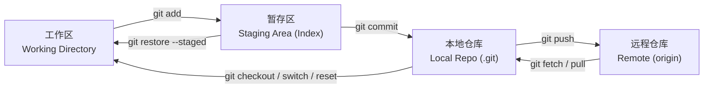

# Git 知识与高频命令实战手册

> [返回 CLI 工具总览](README.md)

---

## 1. 工具定位与核心特点

### 1.1 定位
**Git** 是目前事实标准的**分布式版本控制系统（DVCS）**，用于追踪代码变更、支持多人并行分支开发、代码评审（PR/MR）与版本回溯。它既是个人开发的“时光机”，也是团队工程协作与 CI/CD 流水线的底层基础设施。

### 1.2 核心特点
- **分布式架构**：每个本地克隆都是完整仓库（包含全部历史与分支），离线也能正常 `commit`、`diff`、`log`、`rebase`。
- **轻量级分支**：分支本质上只是指向某个提交（Commit）的 41 字节指针，创建、切换、合并几乎零成本。
- **四区流转模型**：通过**工作区 → 暂存区 → 本地仓库 → 远程仓库**解耦“修改”与“提交”，支持按文件甚至按代码块（`git add -p`）精细构造干净的提交记录。
- **内容寻址与安全网**：所有对象由 SHA-1/SHA-256 哈希标识，已提交的历史极难真正丢失；配合 `git reflog` 几乎能救回绝大多数误操作。



---

## 2. 快速初始化与推荐全局配置

新机器或新容器首次使用 Git 时，建议一次性配置以下基础项：

```bash
# 1. 身份信息（提交记录显示用）
git config --global user.name "Your Name"
git config --global user.email "you@example.com"

# 2. 默认分支名统一为 main
git config --global init.defaultBranch main

# 3. pull 默认使用 rebase（减少无意义的 Merge commit）
git config --global pull.rebase true

# 4. 自动清理远端已删除的追踪分支
git config --global fetch.prune true

# 5. 中文路径不转义为八进制
git config --global core.quotepath false

# 6. macOS/Linux 换行符建议（提交时转 LF，检出不乱改）
git config --global core.autocrlf input

# 7. 查看当前所有生效配置及来源文件
git config --list --show-origin
```

**验证 SSH 连通性**（以 GitHub 为例）：
```bash
ssh -T git@github.com
```

---

## 3. 常用命令速查

### 3.1 仓库初始化与日常提交

| 场景 / 目的 | 命令 | 说明 |
| :--- | :--- | :--- |
| 克隆仓库 | `git clone <url>` | 加 `--depth 1` 浅克隆；加 `--recursive` 一并拉取子模块 |
| 查看当前状态 | `git status -sb` | `-sb` 精简输出（含当前分支与跟踪状态） |
| 暂存改动 | `git add <file>` / `git add -A` | `-A` 暂存全部新增/修改/删除 |
| 交互式按块暂存 | `git add -p` | 只挑选同一文件中的部分改动进入本次提交 |
| 提交到本地仓库 | `git commit -m "feat: xxx"` | 遵循 Conventional Commits 风格更清晰 |
| 修改上一次提交 | `git commit --amend` | 补漏文件或修改提交信息；加 `--no-edit` 保留原信息 |
| 查看未暂存差异 | `git diff` | 对比工作区 vs 暂存区 |
| 查看已暂存差异 | `git diff --staged` | 对比暂存区 vs `HEAD`（提交前自查必用） |

### 3.2 分支与合并 / 变基

| 场景 / 目的 | 命令 | 说明 |
| :--- | :--- | :--- |
| 查看本地/全部分支 | `git branch` / `git branch -a` | 加 `-vv` 可看本地分支与远端追踪关系 |
| 切换分支 | `git switch <branch>` | 新版推荐，替代语义混杂的 `checkout`；`git switch -` 切回上一个分支 |
| 新建并切换分支 | `git switch -c <new-branch>` | 基于当前 `HEAD` 创建分支 |
| 重命名当前分支 | `git branch -m <new-name>` | 仅改本地分支名 |
| 删除已合并/强制删除分支 | `git branch -d <branch>` / `-D` | `-D` 强制删除未合并分支 |
| 合并分支 | `git merge <branch>` | 将 `<branch>` 合并到当前分支；加 `--no-ff` 保留合并节点 |
| 变基到目标分支 | `git rebase <base>` | 将当前分支提交重放至 `<base>` 最新提交之上，保持线性历史 |
| 挑拣单个提交 | `git cherry-pick <commit>` | 把其他分支的指定提交复制到当前分支 |

### 3.3 远端同步与标签

| 场景 / 目的 | 命令 | 说明 |
| :--- | :--- | :--- |
| 查看远端地址 | `git remote -v` | 查看 `origin` 等远端 URL |
| 拉取远端元数据（不合并） | `git fetch --all --prune` | 最安全的同步方式，先看差异再决定合并/变基 |
| 拉取并变基更新 | `git pull --rebase` | 等价于 `fetch` + `rebase` |
| 推送分支并建立追踪 | `git push -u origin <branch>` | 首次推送新分支使用 `-u`，之后直接 `git push` |
| 安全强制推送（变基后） | `git push --force-with-lease` | **严禁无脑 `-f`**；若远端有他人新提交会拒绝覆盖 |
| 删除远端分支 | `git push origin --delete <branch>` | 删除服务器上的分支 |
| 打附注标签并推送 | `git tag -a v1.0.0 -m "release"` && `git push origin v1.0.0` | 发版推荐使用 `-a` 附注标签 |

### 3.4 撤销、回滚与“后悔药”

| 场景 / 目的 | 命令 | 影响范围 |
| :--- | :--- | :--- |
| 放弃工作区某文件修改 | `git restore <file>` | **不可逆**丢弃未暂存修改 |
| 将文件移出暂存区 | `git restore --staged <file>` | 保留工作区改动，仅取消 `git add` |
| 撤销最近一次提交，保留改动在暂存区 | `git reset --soft HEAD~1` | 只移动 `HEAD`，最温和 |
| 撤销最近一次提交，保留改动在工作区 | `git reset --mixed HEAD~1` | `reset` 默认模式 |
| 彻底回退到指定提交（丢弃所有改动） | `git reset --hard <commit>` | 重置 `HEAD` + 暂存区 + 工作区，慎用 |
| 安全撤销已推送的公共提交 | `git revert <commit>` | 新增一条反向提交，**不改写公共历史** |
| 清理未追踪文件与目录 | `git clean -fdn` → `git clean -fd` | 先加 `-n` 预览将删除的文件再执行 |
| 查看 `HEAD` 历史操作轨迹 | `git reflog` | 误 `reset`/`rebase`/删分支后的终极救火工具 |

### 3.5 暂存、历史检索与进阶效率

| 场景 / 目的 | 命令 | 说明 |
| :--- | :--- | :--- |
| 临时保存当前未提交改动 | `git stash push -u -m "wip: xxx"` | `-u` 包含未追踪的新文件 |
| 查看并恢复暂存 | `git stash list` / `git stash pop` | `apply` 恢复后保留记录，`pop` 恢复并删除 |
| 图形化精简日志 | `git log --oneline --graph --decorate --all -n 20` | 一眼看清分支拓扑 |
| 按关键词搜提交历史 | `git log -S "<keyword>" --oneline` | 查找哪次提交引入或删除了某个函数/字符串 |
| 查看每行代码最后修改者 | `git blame -L 10,30 <file>` | 定位问题代码上下文 |
| 二分定位引入 Bug 的提交 | `git bisect start` / `bad` / `good <commit>` | 大跨度历史中 $O(\log N)$ 定位回归提交 |
| 多分支并行目录（互不干扰） | `git worktree add ../repo-fix fix/bug` | 检出已有分支到独立目录（新建分支加 `-b`），无需 `stash` 即可并行编译/调试 |
| 初始化与更新子模块 | `git submodule update --init --recursive` | 含第三方子模块的 C++ 工程高频命令 |

---

## 4. 常见使用流程

### 流程 A：日常功能分支开发 → 同步主干 → 提 PR/MR

```bash
# 1. 从最新主干切出功能分支
git switch main
git pull --rebase
git switch -c feat/add-logger

# 2. 编码、自查差异并分步提交
git status -sb
git diff
git add -p
git commit -m "feat(log): add async file sink"

# 3. 提 PR 前同步主干最新提交，在本地解决冲突
git fetch origin
git rebase origin/main

# 4. 推送远端（若 rebase 过已有远端分支，改用 --force-with-lease）
git push -u origin feat/add-logger
```

### 流程 B：开发到一半需要切分支修紧急 Bug

- **方式 1（轻量，适合快速切分支）**：
  ```bash
  git stash push -u -m "wip: logger refactor"
  git switch -c hotfix/crash-on-null main
  # ... 修复、提交、推送 ...
  git switch feat/add-logger
  git stash pop
  ```
- **方式 2（推荐，适合 C++ 大仓避免重编 `build/`）**：
  ```bash
  # 在同级目录检出一个独立工作树，当前目录编译产物和未提交改动完全不动
  git worktree add ../cpp-notes-hotfix -b hotfix/crash-on-null main
  # 修复并推送完成后清理
  git worktree remove ../cpp-notes-hotfix
  ```

### 流程 C：提 PR 前整理凌乱的本地提交（交互式变基）

```bash
# 整理最近 4 次本地未合并的提交
git rebase -i HEAD~4
```

在弹出的编辑器中常用动作：
- `pick`（`p`）：保留该提交
- `reword`（`r`）：保留改动，仅修改提交信息
- `squash`（`s`）：合并到上一条提交，并编辑合并后的提交信息
- `fixup`（`f`）：合并到上一条提交，直接丢弃本条提交信息
- `drop`（`d`）：删除该提交

### 流程 D：常见误操作救火指南

1. **误执行了 `git reset --hard`，提交找不到了**：
   ```bash
   git reflog                   # 找到重置前的 commit hash，例如 a1b2c3d
   git reset --hard a1b2c3d     # 一键恢复
   ```
2. **代码直接提交到了 `main`（本应提交到新分支）**：
   ```bash
   git branch feat/my-work      # 先在当前提交上新建功能分支保住改动
   git reset --hard origin/main # 把本地 main 重置回远端状态
   git switch feat/my-work      # 切回功能分支继续工作
   ```
3. **代码已经 `push` 到多人共享分支，发现有问题需要撤回**：
   ```bash
   # 不要用 reset + force push，改用 revert 生成安全回滚提交
   git revert <bad-commit-hash>
   git push
   ```

---

## 5. 高频排坑 FAQ

- **Q1：`merge` 或 `rebase` 遇到冲突怎么办？**
  1. 用 `git status` 查看 `both modified` 的冲突文件；
  2. 打开文件解决 `<<<<<<<` / `=======` / `>>>>>>>` 冲突块；
  3. 标记已解决：`git add <resolved-file>`；
  4. 继续流程：`git rebase --continue`（或 `git commit` 完成 merge）；若想放弃本次操作恢复原状，执行 `git rebase --abort` / `git merge --abort`。
- **Q2：`git pull` 报错 `Need to specify how to reconcile divergent branches`？**
  - 本地与远端分支出现分叉且未配置默认策略。临时处理可用 `git pull --rebase`，长期建议全局设置 `git config --global pull.rebase true`。
- **Q3：DevContainer / Docker 容器内无法 `git pull` 私有仓库？**
  - 检查宿主机是否已加载私钥（`ssh-add -l`），以及容器是否正常转发 `SSH_AUTH_SOCK` 环境变量；详见 [VSCode 机器人中台开发指南](../vscode/README.md#6-高频报错排查-faq)。
