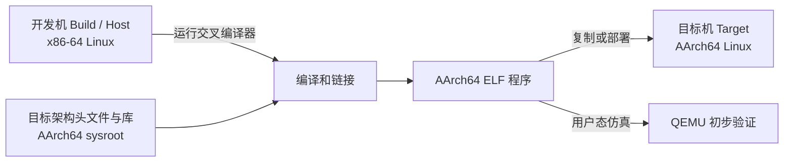
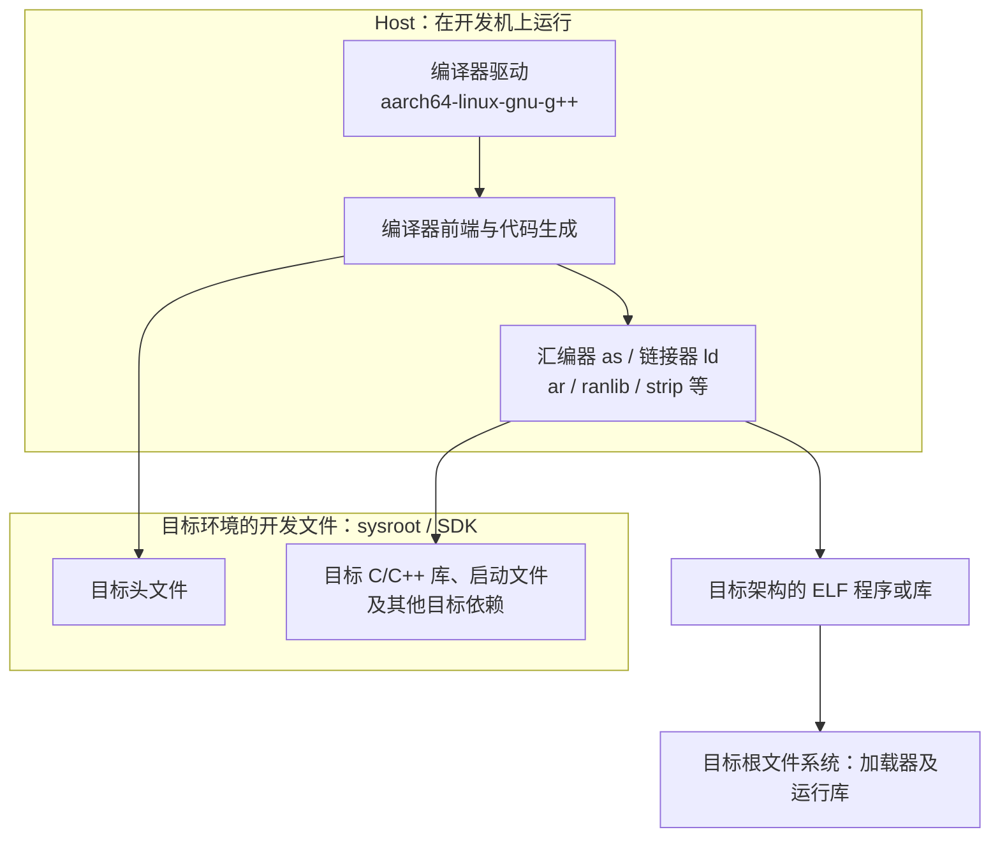
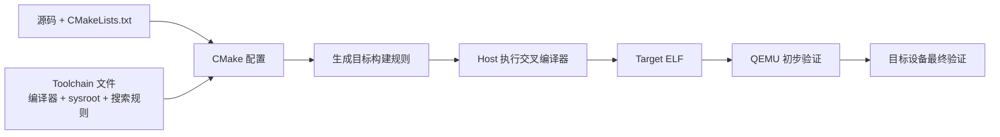
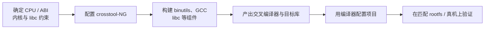

# 交叉编译与工具链

> 阅读目标：理解为什么“在一台机器上编译”和“在另一台机器上运行”需要一整套匹配的工具、头文件和库；能够把一个 x86-64 Linux 程序交叉编译为 AArch64 Linux 程序，并用 QEMU 做初步验证。
>
> 示例以 **x86-64 Ubuntu/Debian 开发机**、**AArch64 Linux 目标机**为例；具体包名、路径、动态加载器和硬件能力会随发行版和工具链变化。文中的 Mermaid 图需要支持 Mermaid 的 Markdown 预览器。

## 1. 交叉编译在解决什么问题

本机编译时，编译器产生的程序通常与编译机使用相同的架构与操作系统。交叉编译则是在一台机器上运行编译工具，生成供另一种目标环境运行的程序。例如，在 PC 上编出 ARM64 开发板能运行的 ELF 文件。



严格来说，工具链构建中常区分三台机器：

| 名称 | 意义 | 本例 |
|---|---|---|
| Build | **构建工具链本身**的机器 | x86-64 Linux |
| Host | **运行编译器**的机器 | x86-64 Linux |
| Target | 编译器**生成代码所面向的环境** | AArch64 Linux |

平时说“Host/Target”通常把 Build 和 Host 当作同一台开发机。构建 Canadian Cross 等特殊工具链时，三者可以不同。这里的 Target 不只是 CPU 名字，还包括操作系统、ABI、C 库及其版本等约束。

### 1.1 目标三元组是什么

`aarch64-linux-gnu` 是常见的目标标识，概括架构、操作系统和 ABI/运行库约定；不同工具链还可能包含厂商字段，实际格式不一定恰好只有三段。类似地，`arm-linux-gnueabihf` 常用于 32 位 ARM 的硬浮点 ABI。

**架构相同不代表一定兼容**：指令集扩展、字节序、调用约定、动态加载器、glibc/musl、C++ ABI、目标库版本都可能影响运行。

## 2. 一套交叉工具链包含什么



- **编译器驱动**：如 `aarch64-linux-gnu-g++`，协调预处理、代码生成、汇编和链接；`g++` 驱动还会处理 C++ 运行时链接。
- **binutils**：提供目标架构的 `as`、`ld`、`ar`、`strip`、`readelf` 等。交叉工具链通常带目标前缀；Clang 也可以配合 LLVM 工具或外部 GNU 工具链。
- **目标 C 库与 C++ 运行时**：例如 glibc 或 musl，以及工具链配套的 libstdc++ / libc++。它们影响头文件、启动文件、动态加载器、运行时行为和 ABI。
- **sysroot**：提供目标文件系统开发视图的目录，例如目标 `/usr/include`、`/usr/lib` 相对于该根目录的内容。编译和链接必须找到**目标架构**的头文件和库，而不是误用开发机的同名文件。
- **目标 rootfs**：设备运行时的根文件系统。sysroot 面向开发，rootfs 面向运行；二者内容可能重叠，但不是天然同一目录，也不是只要同为 AArch64 就能混用。

目标系统的实际 libc、动态加载器与 C++ 库必须满足程序的运行时需求。例如，用较新 glibc 构建的程序可能引用目标机没有的符号版本；因此优先使用设备厂商提供、与目标 rootfs 匹配的 SDK/sysroot，并在实际镜像上验证。musl 和 glibc 不是把 `.so` 文件互换一下就能保证兼容的。

> `compiler --print-sysroot` 有助于了解工具链配置，但有些发行版工具链会报告 `/`，同时通过编译器内置搜索路径或多架构目录寻找目标文件；不能只根据这一行判断是否使用了正确的库。

## 3. 上手：从 x86-64 编出 AArch64 ELF

下面是最小验证流程，不需要先自建工具链。它会在**开发机**安装交叉工具，适合 Ubuntu/Debian；如果已由 SDK 提供工具，不必重复安装。安装操作会修改开发机环境，请按实际权限执行。

### 3.1 安装并确认目标

```bash
sudo apt update
sudo apt install g++-aarch64-linux-gnu binutils-aarch64-linux-gnu qemu-user file

aarch64-linux-gnu-g++ -dumpmachine
# 预期类似：aarch64-linux-gnu
aarch64-linux-gnu-g++ --print-sysroot
```

工具包的目标运行库布局因发行版而异；下面的 QEMU `-L` 路径是 Debian/Ubuntu 多架构交叉包的常见路径，使用前应确认目录存在并包含目标动态加载器。

### 3.2 编译和检查

在临时工作目录中创建 `hello.cpp`：

```cpp
#include <iostream>

int main() {
    std::cout << "Hello from AArch64 Linux!\n";
    return 0;
}
```

```bash
aarch64-linux-gnu-g++ -std=c++17 -O2 -g hello.cpp -o hello-arm64
file hello-arm64
aarch64-linux-gnu-readelf -h hello-arm64
aarch64-linux-gnu-readelf -l hello-arm64
```

`file` 和 ELF header 应显示 AArch64；`readelf -l` 中的 `INTERP` 指出动态加载器路径（具体名字取决于工具链）。这只是检查 ELF 标识和加载要求，并不能证明程序在目标设备上一定可运行。

### 3.3 用 QEMU 用户态运行

```bash
qemu-aarch64 -L /usr/aarch64-linux-gnu ./hello-arm64
# 预期：Hello from AArch64 Linux!
```

`-L` 为 QEMU 用户态执行目标程序时定位目标解释器及库提供前缀；若使用别的 SDK 或 rootfs，应换成与程序匹配的路径。`qemu-aarch64` 是普通用户态程序，**不等于启动一台完整的 ARM Linux 虚拟机**。它翻译目标用户态指令，并将系统调用适配给宿主 Linux 内核；不同内核、设备和硬件相关行为仍可能与真机不一致。

**不要在开发机上用本机 `ldd` 分析不受信任或异架构的程序。**查看目标 ELF 的声明依赖可用：

```bash
aarch64-linux-gnu-readelf -d hello-arm64
# 关注 NEEDED 条目；间接依赖仍需在匹配的目标 rootfs 中进一步检查
```

## 4. CMake 交叉编译：把目标环境写进工具链文件

当项目较大时，将工具链信息交给 CMake，而不是在每个命令中反复写编译器和搜索路径。假设 SDK 提供可在开发机运行的 `aarch64-linux-gnu-gcc/g++`，以及完整、匹配目标设备的 sysroot，创建 `toolchain-aarch64.cmake`：

```cmake
# 本文件在项目配置早期加载。
set(CMAKE_SYSTEM_NAME Linux)
set(CMAKE_SYSTEM_PROCESSOR aarch64)

# 编译器可执行文件在开发机的 PATH 中；也可以写为 SDK 的绝对路径。
set(CMAKE_C_COMPILER aarch64-linux-gnu-gcc)
set(CMAKE_CXX_COMPILER aarch64-linux-gnu-g++)

# 替换成 SDK 中真实存在且与目标 rootfs 匹配的目录。
set(CMAKE_SYSROOT "/opt/my-sdk/sysroot")
set(CMAKE_FIND_ROOT_PATH "${CMAKE_SYSROOT}")

# 构建时要运行的工具来自 Host；目标头文件和库来自 sysroot。
set(CMAKE_FIND_ROOT_PATH_MODE_PROGRAM NEVER)
set(CMAKE_FIND_ROOT_PATH_MODE_LIBRARY ONLY)
set(CMAKE_FIND_ROOT_PATH_MODE_INCLUDE ONLY)
set(CMAKE_FIND_ROOT_PATH_MODE_PACKAGE ONLY)
```

在项目根目录配置和构建：

```bash
cmake -S . -B build-aarch64 \
  -DCMAKE_TOOLCHAIN_FILE="$PWD/toolchain-aarch64.cmake" \
  -DCMAKE_BUILD_TYPE=Release
cmake --build build-aarch64 --parallel
```

以上需要项目已有 `CMakeLists.txt`，且 `/opt/my-sdk/sysroot` 只是示例路径，必须改成实际 SDK 路径；简单的发行版交叉工具链不一定提供可直接照搬的独立 sysroot。CMake 使用 `CMAKE_SYSROOT` 传递编译器 `--sysroot` 并参与查找；工具链还可能有额外的内置搜索路径，需要检查实际链接命令。



- **单独构建目录**：为不同目标、SDK、构建类型使用不同目录。切换工具链时重新配置一个新目录，避免复用旧缓存。
- **配置不等于运行**：交叉编译时，CMake 的 `try_run` 生成的是目标程序，通常无法直接在 Host 执行。应为项目/测试配置适当的 `CMAKE_CROSSCOMPILING_EMULATOR`，或按项目要求预先提供结果；QEMU 也不保证可代替所有真机行为。
- **构建工具与目标依赖分开**：代码生成器等需要在 Host 上运行；应用链接的库必须为 Target 构建。特别注意项目显式写死的绝对路径和导入包配置，它们仍可能绕过默认搜索策略。

### 4.1 `pkg-config` 别找到宿主机的库

`pkg-config` / `pkgconf` 提供的是 `.pc` 文件中的编译、链接选项，不负责替你安装依赖。交叉编译时，可以针对实际 SDK 设置：

```bash
export SYSROOT=/opt/my-sdk/sysroot
unset PKG_CONFIG_PATH
export PKG_CONFIG_SYSROOT_DIR="$SYSROOT"
export PKG_CONFIG_LIBDIR="$SYSROOT/usr/lib/aarch64-linux-gnu/pkgconfig:$SYSROOT/usr/lib/pkgconfig:$SYSROOT/usr/share/pkgconfig"
pkg-config --cflags --libs examplelib
```

`examplelib` 只是需要替换的占位依赖名，且须由 SDK 提供对应 `.pc` 文件；上面的目录也应按 SDK 调整。`PKG_CONFIG_LIBDIR` 替换默认 `.pc` 搜索目录，`PKG_CONFIG_SYSROOT_DIR` 用于重写相关的 `-I`/`-L` 路径。仍要检查 `.pc` 本身及其输出，避免写死 Host 路径，尤其避免把 Host 架构库混入目标链接。

## 5. 从头构建工具链：crosstool-NG

多数时候优先选择发行版或设备厂商已验证的工具链；只有需要自定义 CPU、ABI、C 库或版本组合时，才考虑用 crosstool-NG 自建。



常见步骤：

1. 安装与所用 crosstool-NG 版本对应的构建依赖，并取得 `ct-ng`；参考该版本文档和目标平台 SDK 的约束。
2. 在专用工作目录执行 `ct-ng list-samples` 查看预设；可用 `ct-ng <sample>` 加载与目标最接近的预设，再用 `ct-ng menuconfig` 配置架构、ABI、内核头文件、C 库、编译器版本和安装前缀。`<sample>` 需替换为实际列表中的名称。
3. 执行 `ct-ng build`，等待组件下载和构建完成；构建可能需要网络、磁盘空间和较长时间。保存配置、版本和输入来源，便于复现。
4. 将生成的 `bin` 加入 PATH，用 `<target>-g++ -dumpmachine`、编译小程序和 `readelf` 检查产物，并结合目标 rootfs/真机验证。厂商闭源库或设备 ABI 仍需单独匹配。

## 6. QEMU 两种模式与验证边界

| 模式 | 模拟的内容 | 适合检查 | 不能代替 |
|---|---|---|---|
| 用户态，例如 `qemu-aarch64` | 目标用户态指令，系统调用适配到宿主内核 | 程序能否加载、基本功能、自动化冒烟测试 | 目标内核、真实驱动、板级硬件或准确性能 |
| 系统级，例如 `qemu-system-aarch64` | 模拟机器并启动目标内核和 rootfs | 在支持的虚拟硬件上验证启动和系统集成 | 厂商板卡、专用外设与实际硬件时序 |

建议按 **ELF 静态检查 → QEMU 用户态 → 匹配的目标镜像 / 系统级仿真 → 真机** 逐层验证。不要将 QEMU 测得的耗时直接当成目标设备的性能结论。

## 7. 常见错误如何排查

| 现象 | 常见原因 | 检查方向 |
|---|---|---|
| `Exec format error` | 尝试直接运行不被当前内核支持的架构 | `file`、`readelf -h`；使用正确设备或仿真器 |
| ELF 文件存在却报 `No such file or directory` | 动态加载器路径缺失或不匹配 | `readelf -l` 的 `INTERP`；确认目标 rootfs 和 QEMU `-L` |
| `GLIBC_x.y not found` 或 `GLIBCXX_x.y.z not found` | 目标运行库缺少构建时引用的符号版本 | 核对 SDK 与 rootfs；检查 `readelf --version-info` 的版本需求，使用兼容的工具链和库 |
| `file in wrong format` / 架构不匹配 | 混入宿主机的 `.o`、`.a` 或 `.so` | 查看构建日志、`file`、`readelf -h` 和依赖搜索路径 |
| 能编译但链接 `undefined reference` | 目标库缺失、链接顺序/ABI 不匹配或依赖没传递 | 查看完整链接命令、库的架构和符号；先定位缺失符号 |
| `cannot find ...`、缺少头文件 | sysroot 不完整、路径配置错误，或缺少目标开发包 | 检查编译器 `-v` 的搜索路径、SDK 文档和开发包内容 |
| 在 QEMU 正常、真机失败 | rootfs、内核、指令集扩展或外设不同 | 对照真实设备的加载器、库版本、CPU 能力和日志 |

## 8. 一页记忆

1. **Host 运行工具，Target 运行产物**；还要分清构建工具链本身的 Build。
2. 编译器、binutils、目标头文件、库、动态加载器和 CPU/ABI 是一个需要匹配的整体。
3. **sysroot 是开发时目标环境视图，rootfs 是运行时环境**；保持二者与工具链一致。
4. CMake toolchain 文件确定交叉编译器和目标搜索边界；`pkg-config` 也要限制目标 `.pc` 路径。
5. QEMU 有助于及早发现错误，但最终以目标设备和实际镜像验证为准。
