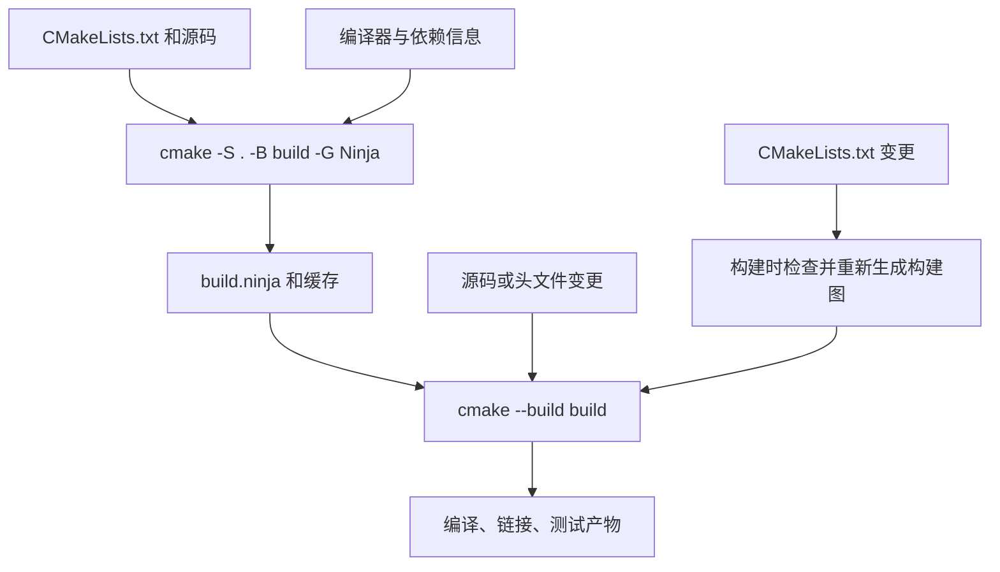
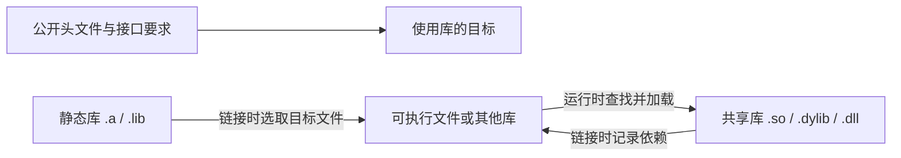
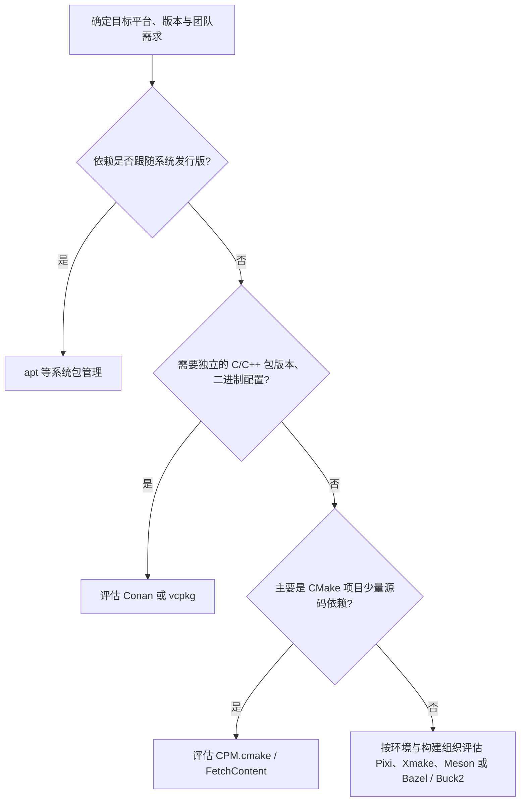

# C++ 构建系统与包管理

一个 C++ 项目从源码到可运行程序，通常要经过依赖发现、构建图生成、编译、链接和运行时加载。构建工具回答的是“哪些文件需要怎样重新生成”；包管理工具回答的是“依赖从哪里来、用什么版本和配置”。两者可以协作，但不能互相替代。


## 1. 工具如何分工

| 工具 | 主要职责 | 典型用法与边界 |
| --- | --- | --- |
| Make / Ninja | 按依赖图执行构建命令 | Make 读取 Makefile；Ninja 通常读取 CMake 等生成的 `build.ninja`。二者本身不是 C++ 编译器 |
| CMake | 描述目标、检查环境并生成构建系统 | 可生成 Ninja 或 Make 构建文件；实际编译和链接由编译器、链接器及构建执行器完成 |
| apt | Debian / Ubuntu 的系统包管理 | 安装发行版打包的软件和开发文件；版本受发行版软件源影响 |
| pkg-config | 查询已安装库的编译、链接元数据 | 从 `.pc` 文件取得版本、头文件和库参数；**不安装、不下载依赖** |
| Conan / vcpkg | C/C++ 包及依赖管理 | 处理依赖版本、构建配置和二进制包，并与 CMake 等构建工具配合 |
| CPM.cmake | CMake 项目内的依赖获取辅助工具 | 基于 CMake 的 `FetchContent` 获取依赖源码；不是系统包管理器，也不能自动保证供应链安全 |
| Pixi | 项目环境与包管理 | 管理 conda 生态环境和依赖，可同时容纳 C++、Python 工具；项目仍需要构建系统 |
| Xmake | 构建系统，也提供包管理能力 | 可用自身项目描述、构建流程和包机制，不必先采用 CMake |
| Meson | 构建系统及配置工具 | 通常生成 Ninja 构建图；依赖可来自系统或 Meson 的子项目 / wrap 机制 |
| Bazel / Buck2 | 面向大型代码库的构建系统 | 通过显式依赖和构建规则组织项目；外部依赖管理能力存在，但不等同于 apt 这样的系统包管理器 |

工具之间不是“一层只能选一个”的关系。例如，Conan 可以准备依赖，CMake 生成构建图，Ninja 执行构建，最终程序运行时再由系统加载动态库。

## 2. Make、CMake 与 Ninja 的核心工作流

### 2.1 Make：目标、依赖和配方

Makefile 中每条规则形如 `目标: 依赖`，后面的配方描述生成目标的命令。Make 通常根据文件是否存在及修改时间判断目标是否过期。下面是一个最小示意，其中配方行的缩进必须是 **Tab**，不是空格。

```makefile
CXX := c++
CXXFLAGS := -std=c++17 -Wall -Wextra -MMD -MP

app: main.o
	$(CXX) main.o -o app

main.o: main.cpp
	$(CXX) $(CXXFLAGS) -c main.cpp -o main.o

-include main.d

.PHONY: clean
clean:
	rm -f app main.o main.d
```

准备同目录的 `main.cpp` 后，运行 `make`；再次运行时，未变化的目标通常不会重建。`make -j4` 最多并行执行 4 个任务，`make clean` 清理示例产物。这里的 `-MMD -MP` 由 GCC 或 Clang 生成 `main.d`，`-include` 把头文件依赖加入图中；如果遗漏这些依赖，修改头文件后可能错误地跳过编译。大型项目手写完整依赖图容易出错，这正是 CMake 等工具有价值的地方。

### 2.2 CMake 配置、生成，Ninja 执行



- **配置与生成**：`cmake -S . -B build -G Ninja` 在独立的 `build` 目录中检查工具链并生成 Ninja 构建文件。选项和路径保存在 `CMakeCache.txt`。
- **执行**：`cmake --build build` 调用所选生成器对应的构建工具；也可以直接运行 `ninja -C build`。Ninja 负责依赖排序、并行调度和增量构建，不负责理解 `CMakeLists.txt`。
- **测试**：项目通过 `enable_testing()` 和 `add_test()` 注册测试后，运行 `ctest --test-dir build --output-on-failure`。
- **重新配置**：调整 CMake 选项时显式再次执行 `cmake -S . -B build ...`。生成器或编译器等基础工具链要改变时，优先使用新的构建目录，避免复用不匹配的缓存。

### 2.3 完整示例：静态或共享库 + 可执行程序

以下示例适用于安装了 CMake 3.20 或更高版本、Ninja、支持 C++17 的 C++ 编译器以及 POSIX shell 的环境；以下 `ctest --test-dir` 用法需要 CMake / CTest 3.20 或更高版本。在 Debian / Ubuntu 上可先运行：

```sh
sudo apt update
sudo apt install build-essential cmake ninja-build
cmake --version
ninja --version
```

发行版提供的 CMake 版本可能低于 3.20；如版本不足，需要从可信来源另行准备满足要求的 CMake。不同环境下构建工具的安装方式也可能不同。

在任意工作目录创建示例项目；以下命令会创建并写入 `build-demo` 目录内的文件，请勿在已有同名项目中直接执行。

```sh
mkdir -p build-demo/include build-demo/src
cd build-demo

cat > include/mymath.hpp <<'EOF'
#pragma once

#include "mymath_export.h"

MYMATH_EXPORT int add(int a, int b);
EOF

cat > src/mymath.cpp <<'EOF'
#include "mymath.hpp"

int add(int a, int b) {
    return a + b;
}
EOF

cat > src/main.cpp <<'EOF'
#include "mymath.hpp"
#include <iostream>

int main() {
    const int result = add(2, 3);
    std::cout << "2 + 3 = " << result << '\n';
    return result == 5 ? 0 : 1;
}
EOF

cat > CMakeLists.txt <<'EOF'
cmake_minimum_required(VERSION 3.20)
project(build_demo LANGUAGES CXX)

option(BUILD_SHARED_LIBS "Build shared libraries" OFF)

add_library(mymath src/mymath.cpp)
file(MAKE_DIRECTORY "${CMAKE_CURRENT_BINARY_DIR}/generated")
include(GenerateExportHeader)
generate_export_header(mymath
    EXPORT_FILE_NAME "${CMAKE_CURRENT_BINARY_DIR}/generated/mymath_export.h")

if(NOT BUILD_SHARED_LIBS)
    target_compile_definitions(mymath PUBLIC MYMATH_STATIC_DEFINE)
endif()
set_target_properties(mymath PROPERTIES
    CXX_VISIBILITY_PRESET hidden
    VISIBILITY_INLINES_HIDDEN YES)
target_compile_features(mymath PUBLIC cxx_std_17)
target_include_directories(mymath PUBLIC
    "${CMAKE_CURRENT_SOURCE_DIR}/include"
    "${CMAKE_CURRENT_BINARY_DIR}/generated")

add_executable(demo src/main.cpp)
target_link_libraries(demo PRIVATE mymath)

enable_testing()
add_test(NAME demo_runs COMMAND demo)
EOF
```

构建并运行默认的静态库版本：

```sh
cmake -S . -B build -G Ninja
cmake --build build
./build/demo
ctest --test-dir build --output-on-failure
```

预期程序输出 `2 + 3 = 5`，测试通过。若要在另一个构建目录中生成共享库版本：

```sh
cmake -S . -B build-shared -G Ninja -DBUILD_SHARED_LIBS=ON
cmake --build build-shared
./build-shared/demo
ctest --test-dir build-shared --output-on-failure
```

`add_library` 未指定类型时遵循 `BUILD_SHARED_LIBS`。`GenerateExportHeader` 生成 `MYMATH_EXPORT`：共享库构建时用于标记公开符号，静态库版本通过公开的 `MYMATH_STATIC_DEFINE` 关闭导入 / 导出标记。`PUBLIC` 头文件目录和 C++ 标准要求会传播给 `demo`，其中还包括生成的导出头文件目录；`demo` 自己对 `mymath` 的链接写为 `PRIVATE`，因为 `demo` 是最终可执行程序。示例仅演示构建树内使用，没有实现库的安装或导出；安装后的项目需分别处理安装接口、头文件和运行时库位置。

### 2.4 修改后如何增量构建

在上面的 `build-demo` 目录内：

```sh
# 无变化时，通常无需重新编译。
cmake --build build

# 修改实现：重新编译 mymath.cpp，再重新链接受影响的目标。
printf '\n' >> src/mymath.cpp
ninja -C build -n
cmake --build build

# 修改公开头文件：引用它的源文件也需重新编译。
printf '\n' >> include/mymath.hpp
ninja -C build -n
cmake --build build
ctest --test-dir build --output-on-failure
```

`ninja -n` 只预览任务，不执行；具体任务取决于当前构建状态。CMakeLists、工具链选项和依赖配置变化可能需要重新配置或重新生成构建图。源码依赖通常由编译器生成的依赖信息维护，避免靠人工列举每个头文件。

如果新增或升级第三方依赖，应先确定版本和来源，更新对应包管理器的清单 / 锁文件或系统环境，再重新运行 CMake 配置与构建，最后运行测试。不同构建目录的缓存与产物相互独立；不要假设更新一个目录会自动更新另一个目录。

## 3. 静态库、共享库和接口传播



- **静态库**是目标文件的归档，链接器根据引用选取其中所需部分。程序仍可能依赖其他共享库；静态链接某个库不等于整个程序完全静态。
- **共享库**在运行时由加载器查找和加载。Linux 常见 `.so`，macOS 常见 `.dylib`，Windows 常见 `.dll`；Windows 编译链接时通常还使用对应的导入库 `.lib`。部署时要保证正确版本的共享库及其传递依赖可被加载器找到，不能只复制可执行文件。
- 典型项目将公开头文件放入 `include/`，实现放入 `src/`，按目标设置包含路径、编译要求和依赖；安装给其他项目使用时还应提供安装路径和可供发现的包配置。不要把整个项目的私有目录全局加入所有目标。

CMake 的目标属性应表达实际接口：

| 关键字 | 对当前目标生效 | 传递给使用者 | 常见用途 |
| --- | --- | --- | --- |
| `PRIVATE` | 是 | 通常不传播编译使用要求 | 仅实现使用的头文件路径或编译选项 |
| `PUBLIC` | 是 | 是 | 自己和公开头文件的使用者都需要的路径、定义或依赖 |
| `INTERFACE` | 否 | 是 | 仅供使用者使用的要求，例如纯头文件库的包含目录 |

例如公开头文件包含依赖库的头文件，或公开类型直接使用该库的类型时，通常需要把该依赖的使用要求设为 `PUBLIC`；只有实现文件使用时通常设为 `PRIVATE`。**链接依赖有细节**：静态库本身不完成最终链接，CMake 可能将其 `PRIVATE` 链接库作为仅链接要求传递给最终使用者；这不等于同时传播那个依赖的头文件路径等编译要求。应以实际公开接口和目标依赖关系为准。

## 4. 符号可见性与 ABI

共享库应尽量只导出承诺支持的公共接口，避免内部符号冲突、缩小暴露面。支持的平台上可默认隐藏符号，再用导出宏标记公开 API；Windows 通常使用 `__declspec(dllexport)` / `__declspec(dllimport)`。上例使用 CMake 的 `GenerateExportHeader` 处理平台差异，并对静态库禁用导入 / 导出属性。可见性设置不会自动决定哪些接口稳定，也不能代替权限或安全隔离。

ABI（二进制接口）涉及符号名和调用约定、类型布局和对齐、虚函数表、异常、运行时及标准库等。头文件能编译通过，不代表已有二进制库一定能安全链接和运行。C++ ABI 尤其容易受编译器及其版本、标准库实现和 ABI 选项、目标架构、构建配置等影响。

- 升级库时核对该库的 ABI 兼容承诺，以及编译器、标准库、架构、运行时和构建选项；不确定时使用一致工具链重建依赖及消费者。
- 修改公开类的数据成员、虚函数或函数签名等可能破坏 ABI；接口增加也应结合具体 ABI 和兼容策略评估。语义版本号和共享库 SONAME 有助于管理版本，但不是兼容性的证明。
- 若需要跨编译器或跨语言的较稳定边界，可考虑 `extern "C"` 函数、固定约定的数据类型、opaque handle，并约定资源由哪一侧分配和释放。`extern "C"` 主要改变语言链接约定，**不会自动保证**结构布局、运行时或内存管理兼容。

## 5. 系统依赖：apt 与 pkg-config

以下 apt 命令仅针对 **Debian / Ubuntu 及其兼容软件源**；其他发行版请使用其自身包管理器。发行版的开发包通常包含头文件、链接所需文件及元数据，而运行时包只提供运行所需内容。例如：

```sh
sudo apt update
sudo apt install build-essential pkg-config libfmt-dev
pkg-config --modversion fmt
pkg-config --cflags --libs fmt
```

`pkg-config` 搜索已安装的 `.pc` 元数据，输出对应的编译和链接参数。搜索路径和可用包取决于系统环境；跨编译时应使用目标平台的 sysroot 和相应 `.pc` 文件，而不是误用宿主机路径。CMake 项目可使用 `find_package(PkgConfig REQUIRED)`，再以 `pkg_check_modules(FMT REQUIRED IMPORTED_TARGET fmt)` 创建 `PkgConfig::FMT`，通过 `target_link_libraries` 链接。具体包是否提供 `.pc` 文件取决于上游或发行版。

系统包适合与发行版紧密集成的程序和统一维护的运行环境；代价是版本和配置由发行版决定，同机项目可能难以独立选择不同版本。容器可固定操作系统环境，但仍需固定基础镜像与软件源版本，才能更好地复现。

## 6. 怎样选择依赖管理方案



- **apt + 容器**：适合强依赖 Ubuntu / Debian 环境、重视系统集成的项目。确认目标发行版提供所需版本；镜像不自动解决 ABI 或供应链问题。
- **vcpkg**：适合跨平台 C++ 项目，希望通过清单、triplet 和 CMake 集成管理依赖。仍应固定注册表基线、triplet 和工具链，并验证目标平台上的包是否可用。
- **Conan 2**：适合多平台、交叉编译、私有包仓库和多种二进制配置的团队。需要明确 host / build profile、配置和锁定策略；包的复用依赖这些配置匹配。
- **CPM.cmake**：适合已经使用 CMake、依赖数量较少且愿意从源码构建的项目。固定可信的不可变提交或版本并核验来源；依赖会进入项目配置和构建流程，不一定适合统一管控大量二进制包。
- **Pixi**：适合 C++ 与 Python 等工具共存的开发环境，利用环境与锁文件约束依赖；仍需考虑所用 channel 的包、平台覆盖和 ABI，以及具体项目的构建系统。
- **Xmake / Meson**：适合愿意采用新构建描述的新项目。评估团队熟悉度、依赖集成、平台和 IDE 支持；Meson 通常配合 Ninja，Xmake 自带包管理能力。
- **Bazel / Buck2**：适合需要明确依赖图、缓存和大规模多语言构建的单仓库，但引入规则、迁移和维护成本；规模本身不是选型的充分理由。

不论使用哪种工具，都应固定并审查依赖来源、版本及构建配置，按团队需要维护锁文件或镜像，检查许可证与漏洞，并在干净环境验证构建。**不可信依赖存在执行代码风险**：包安装脚本、CMake 配置、构建脚本以及程序加载和运行库时都可能执行第三方代码。不要在有敏感凭据或高权限的环境中直接构建、安装或运行未经审查的库。
