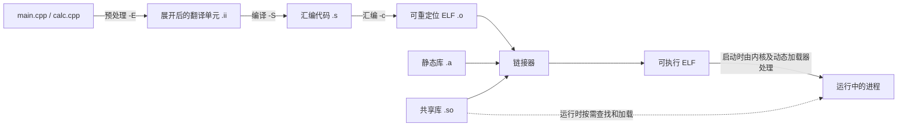
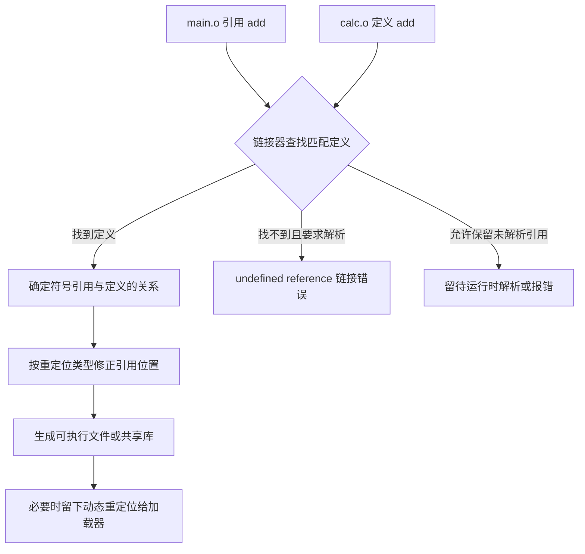
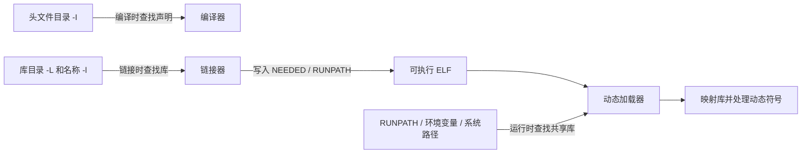

# C++ 编译与链接原理

## 1. 从源代码到进程

一个 C++ 程序通常由多个源文件组成。**每个源文件连同它包含的头文件，经预处理后形成一个翻译单元**；编译器分别处理这些翻译单元，链接器再将所需定义组合起来。`g++` 和 `clang++` 是驱动程序，会按选项调用预处理器、编译器、汇编器和链接器，并在链接 C++ 程序时加入必要的运行库。



- **预处理**：处理 `#include`、宏和条件编译等，得到预处理后的文本。包含头文件通常只是让编译器看到声明，并不自动提供对应实现。
- **编译**：检查语法和类型、生成中间表示并进行优化，再生成目标架构的汇编。一个翻译单元的语义错误通常在此阶段暴露。
- **汇编**：将汇编转换为机器码和其他数据，产生通常仍有待解析引用的 `.o` 文件。
- **链接**：合并输入，解析符号并应用或生成重定位，产生可执行文件或共享库。源文件互相调用时，声明正确并不意味着链接时一定能找到定义。
- **加载与运行**：内核建立进程映像；动态链接程序还由 ELF 解释器加载所需共享库、完成必要的动态重定位，再进入程序。部分符号可延迟到首次调用时绑定。

上图是便于观察的逻辑分段；实际驱动可能直接在内部传递结果，不一定生成中间文件。扩展名只是常见约定，不决定文件格式。

## 2. 可复现实验：观察各个阶段

### 2.1 环境与源文件

以下实验面向 **GNU/Linux**，需要 C++ 编译器、GNU binutils（`ar`、`nm`、`readelf`、`objdump`）、GNU 链接器 `ld.bfd`、glibc 动态加载器及常见 shell 工具。示例使用 `g++`；除明确指定 GNU 链接器及 glibc 的部分外，也可按需换成 `clang++`。某些发行版需安装对应开发工具包。命令中的 `-fuse-ld=bfd` 要求驱动能找到 `ld.bfd`。

在一个**空的、可写的实验目录**中执行以下命令；后续命令均假设当前目录不变。这里的重定向会创建或覆盖同名文件，不要在已有项目目录中直接执行。

```bash
demo_dir=$(mktemp -d "${TMPDIR:-/tmp}/cpp-link-demo.XXXXXXXX")
cd "$demo_dir"

cat > calc.h <<'EOF'
#pragma once
int add(int a, int b);
EOF

cat > calc.cpp <<'EOF'
#include "calc.h"
int add(int a, int b) { return a + b; }
EOF

cat > main.cpp <<'EOF'
#include "calc.h"
#include <iostream>
int main() {
    std::cout << add(2, 3) << '\n';
}
EOF
```

`main.cpp` 看到了 `add` 的声明；函数定义位于另一个翻译单元 `calc.cpp`。接下来用编译器驱动显式停在不同阶段：

```bash
g++ -std=c++17 -E main.cpp -o main.ii  # Preprocess
g++ -std=c++17 -S calc.cpp -o calc.s   # Compile to assembly
g++ -std=c++17 -c main.cpp -o main.o   # Compile and assemble
g++ -std=c++17 -c calc.cpp -o calc.o
g++ main.o calc.o -o app-objects        # Link
./app-objects                           # Output: 5
```

`-E`、`-S`、`-c` 分别是“停在预处理、汇编文本、目标文件”阶段；它们不是必须拆开执行的步骤。`main.ii` 因展开标准库头文件可能很长，`calc.s` 的指令则依架构、编译器和选项而变。`-o` 指定输出路径；不提供 `-c`、`-S` 或 `-E` 时，驱动通常继续执行链接。

### 2.2 ELF 目标文件中有什么

```bash
file main.o app-objects
readelf -hW main.o
readelf -SW main.o
readelf -sW main.o
readelf -rW main.o
nm -C main.o
objdump -drC main.o
```

重点观察，不必期待地址、节数量或指令逐字相同：

- `readelf -hW` 中目标文件一般为 `ET_REL`（可重定位文件）。可执行程序可能是 `ET_EXEC`，也可能因为默认启用 PIE 而是 `ET_DYN`；共享库也通常是 `ET_DYN`，不能仅凭这一字段断言文件用途。`file` 和 ELF 头、程序头应结合判断。
- **节（section）**组织链接视角下的内容：`.text` 常放代码，`.rodata` 常放只读数据，`.data` 放已初始化可写数据，`.bss` 表示零初始化存储；`.symtab`、`.strtab` 和重定位节支持符号及地址处理。具体节名由工具链决定。
- **符号表**记录定义和引用等信息。`nm -C main.o` 中通常能看到 `U add(int, int)`：`U` 表示此目标文件引用了尚未在自身定义的符号；`-C` 将 C++ 修饰名还原为便于阅读的名称。`nm -C calc.o` 通常能看到对应的 `T add(int, int)` 定义。
- **重定位项**告诉链接器或加载器：某处地址或位移需要依据符号及重定位类型计算和修正。`objdump -drC` 将反汇编与重定位信息一起展示；具体类型和指令依 CPU 架构而异。
- 可执行文件或共享库的**程序头（segment）**描述运行时映射等信息，可用 `readelf -lW app-objects` 查看。节是链接、分析时的重要视角，段是装载时的重要视角；二者不是一一对应关系。

## 3. 符号解析与重定位



例如，`main.o` 中调用 `add` 的指令尚不知道最终位置；链接器选择匹配定义后，按目标架构的规则计算调用位移或相关地址。动态链接情况下，部分地址需要加载时甚至首次调用时才能确定，常见实现借助 GOT / PLT 等机制，但具体细节依架构和链接选项而定。生成共享库时某些链接器默认允许保留未解析的外部引用，因此不一定当场报错；需要更严格检查时，可在 GNU/Linux 上视项目情况使用 `-Wl,-z,defs`。

符号解析与 C++ 的几个约束密切相关：

- **名字修饰（name mangling）**通常编码函数名、命名空间和参数类型等，以支持重载。声明和定义签名不一致、命名空间不同，可能得到不同符号；用 `nm -C` 和 `readelf -sW` 对照。C++ 标准并不规定统一的修饰方案。
- **ODR（单一定义规则）**约束实体的定义数量与一致性。不同翻译单元中某些实体（如符合条件的 `inline` 函数或模板）允许重复定义，但必须满足 ODR 的一致性等要求。违规可能报 multiple definition，也可能无法诊断并导致未定义行为；链接成功不是 ODR 正确的证明。
- **ABI（二进制接口）**涉及调用约定、对象布局、符号修饰、异常、标准库等。不同编译器版本、标准库或构建选项未必兼容；即使符号名匹配也不能保证布局和行为兼容。跨库传递 C++ 对象时尤其要统一工具链及 ABI 设置。`extern "C"` 只指定语言链接方式，并不自动解决对象布局或完整 ABI 兼容性。

## 4. 静态库：归档、提取与顺序

静态库 `.a` 是一组目标文件的归档，并非已经完成最终链接的可执行文件。继续在实验目录执行：

```bash
ar rcs libcalc.a calc.o
ar t libcalc.a
nm -C libcalc.a

g++ -fuse-ld=bfd main.o -L. -l:libcalc.a -o app-static-calc
./app-static-calc  # 5
```

`-L.` 添加**链接时**的库搜索目录；GNU 链接器支持的 `-l:libcalc.a` 精确选择文件名。在使用 `-lcalc` 时，如果同目录同时有 `libcalc.so` 和 `libcalc.a`，动态链接默认情况下通常优先选择 `.so`；具体行为受链接器和选项影响。

对 GNU `ld.bfd` 的常见规则，链接器按命令行从左到右处理输入：遇到归档时，只提取能满足**当前未解析引用**的成员，再按需要继续从该归档提取成员。已经处理过的归档通常不会因为后面才出现新的未解析引用而自动重扫。因此使用库的对象通常放在库前：

```bash
# Deliberately wrong order: expect an undefined reference
g++ -fuse-ld=bfd -L. -l:libcalc.a main.o -o app-wrong-order

# Correct order: resolve the existing add reference from the archive
g++ -fuse-ld=bfd main.o -L. -l:libcalc.a -o app-right-order
./app-right-order  # 5
```

实际工具链行为可能不同，例如某些链接器会回看先前归档；此示例明确选用 `ld.bfd`。若多个静态库相互依赖，可先调整顺序；确有循环依赖时，GNU 链接器可用 `-Wl,--start-group ... -Wl,--end-group` 包围相关库，使它们被反复搜索，代价是链接可能变慢。

**静态链接某个库不等于整个程序完全静态链接。** 上面的 `app-static-calc` 把所需 `calc.o` 成员纳入结果，但 C++ 标准库和系统库仍可能是动态依赖；可用 `readelf -dW app-static-calc` 检查。完全静态链接通常需要 `-static` 及所有依赖的静态版本，还应考虑平台限制和部署方式。

## 5. 动态库：链接与运行时查找

### 5.1 创建并使用共享库

先独立编译位置无关代码，再创建共享库。下面使用常见的 SONAME 和符号链接约定：

```bash
mkdir -p lib
g++ -std=c++17 -fPIC -c calc.cpp -o calc.pic.o
g++ -shared -Wl,-soname,libcalc.so.1 calc.pic.o -o lib/libcalc.so.1.0
ln -s libcalc.so.1.0 lib/libcalc.so.1
ln -s libcalc.so.1 lib/libcalc.so

# Find libcalc.so at link time and record a relative runtime search path
g++ main.o -Llib -lcalc -Wl,--enable-new-dtags,-rpath,'$ORIGIN/lib' -o app-shared
./app-shared  # 5

readelf -dW lib/libcalc.so.1.0  # Inspect SONAME
readelf -dW app-shared          # Inspect NEEDED and RUNPATH
nm -D -C lib/libcalc.so.1.0     # Inspect dynamic symbols
```

`libcalc.so` 是本例**链接时**供 `-lcalc` 查找的名称；库内的 `SONAME` 是 `libcalc.so.1`，链接后的可执行文件通常在 `DT_NEEDED` 中记录这个名称；`libcalc.so.1` 链接到实际文件 `libcalc.so.1.0`，供**运行时**查找。将 SONAME 主版本用作 ABI 兼容性标识是惯例，不是自动的兼容性保证。本例显式使用 GNU 链接器的 `--enable-new-dtags` 生成 `DT_RUNPATH`。`'$ORIGIN/lib'` 的单引号防止 shell 提前展开，`$ORIGIN` 由动态加载器相对于包含该路径条目的 ELF 对象所在目录展开。

三个问题必须分开：`#include` 在**预处理/编译**时查找声明；`-L`/`-l` 在**链接**时查找库并记录依赖；动态加载器在**运行**时查找实际共享库。链接成功并不保证部署后运行成功。`-I` 指定头文件搜索目录，`-L` 指定链接器的库搜索目录，二者都不会自动成为运行时搜索目录。



### 5.2 运行时搜索路径与风险

对于 glibc 动态加载器，在依赖名称**不含斜杠**的常见情况下，搜索过程概括如下，具体规则和例外以本机 `man 8 ld.so` 为准：

1. 若对象有 `DT_RPATH` 且没有 `DT_RUNPATH`，先考虑其 `RPATH`。
2. 考虑 `LD_LIBRARY_PATH`；安全执行模式下该变量会被忽略等处理。
3. 考虑相关对象的 `DT_RUNPATH`：它通常只用于该对象的**直接依赖**，不自动传递给依赖的子依赖。旧式 `RPATH` 的适用范围和优先级不同，可影响更深层依赖。
4. 查找系统加载器缓存及默认库目录，具体受配置、硬件能力目录及链接选项等影响。

若依赖字符串包含斜杠，加载器会将其作为路径处理，而非按上述普通名称搜索。实际项目中，给每个需要查找私有依赖的 ELF 对象设置合适的 `RUNPATH` 往往比依赖可执行文件的路径传递更可靠。

可在本例中对比不内置运行路径的版本：

```bash
g++ main.o -Llib -lcalc -o app-no-runpath
readelf -dW app-no-runpath
# Without a matching system library, running directly normally fails
LD_LIBRARY_PATH="$PWD/lib" ./app-no-runpath  # 5
```

`LD_LIBRARY_PATH` 是进程环境级别的搜索路径，并非链接器的 `-L`，也不是适合所有场景的部署方案。它可能使程序加载到非预期或不可信的库；避免把可由他人写入的目录、空路径项或当前目录放进去，尤其不要依赖它处理特权程序。`$ORIGIN` 相对路径便于随程序一起部署，但也要保证程序目录和库目录可信、权限正确。

`ldd ./app-shared` 可辅助查看**当前环境**中的依赖解析，结果不是部署到另一台机器后的保证。不要对不可信的可执行文件使用 `ldd`；静态检查直接依赖可用 `readelf -dW`，但它不会展示完整递归依赖树。必要时，在可信程序上使用 `LD_DEBUG=libs ./app-shared` 观察 glibc 的搜索过程。

### 5.3 PIC 与 PIE

`-fPIC` 为共享库生成适合位置无关加载的代码，使同一个库可映射到不同进程的不同地址。`-fPIE` / `-fpie` 为位置无关**可执行文件**生成代码，链接时配合 `-pie`。某些发行版默认开启 PIE，具体以驱动配置为准。PIE 有助于 ASLR 发挥作用，但不等同于 ASLR，也不替代其他安全措施。

```bash
g++ -std=c++17 -fPIE -c main.cpp -o main.pie.o
g++ -std=c++17 -fPIE -c calc.cpp -o calc.pie.o
g++ -pie main.pie.o calc.pie.o -o app-pie
./app-pie  # 5
```

## 6. GCC / Clang 常用选项与优化

| 目的 | 常用选项 | 说明 |
| --- | --- | --- |
| 语言标准 | `-std=c++17`、`-std=c++20` | 选择语言模式；所有文件应使用兼容的设置 |
| 警告 | `-Wall -Wextra -Wpedantic` | 开启常用诊断；不是所有警告，也不能证明程序正确 |
| 头文件 | `-Iinclude`、`-isystem path` | 添加普通或系统头文件搜索目录；警告处理有所不同 |
| 宏 | `-DNAME=value`、`-UNAME` | 定义或取消宏；不同翻译单元的配置可能影响 ABI 和 ODR |
| 调试信息 | `-g` | 写入调试信息；可与优化同时使用 |
| 库 | `-Lpath -lname`、`-pthread` | 分别处理库搜索/选择及线程支持；需要线程时通常在编译和链接阶段均使用 `-pthread` |
| 链接器选项 | `-Wl,option` | 由编译器驱动转发选项给链接器，例如 `-Wl,-soname,libcalc.so.1` |
| 链接时优化 | `-flto` | 允许跨翻译单元优化；编译及链接都应使用兼容的工具链和选项 |

优化级别是策略集合，不是性能保证；不同版本和目标平台的具体优化项可能不同：

- `-O0`：以较少优化为主，通常更容易逐行调试；执行性能不代表发布版本。
- `-Og`：针对调试体验选择部分优化，常与 `-g` 搭配；仍可能有变量被优化掉或执行顺序变化。
- `-O1` / `-O2`：启用更多优化。`-O2` 是常见的发布构建起点，应通过实际负载和基准验证。
- `-O3`：在 `-O2` 基础上增加更激进的优化；可能更快，也可能因代码体积或其他因素更慢。
- `-Os`：倾向减小代码体积；`-Oz` 在支持的 GCC / Clang 版本中进一步偏向体积，需检查本机版本支持。
- `-Ofast`：启用可能改变标准语义的激进选项，包括对浮点运算的宽松假设；不要未经验证就使用。

调试示例与发布诊断示例：

```bash
# Build with warnings and debug information
g++ -std=c++17 -Wall -Wextra -Wpedantic -Og -g main.cpp calc.cpp -o app-debug
./app-debug

# Keep debug information in an optimized build
g++ -std=c++17 -O2 -g main.cpp calc.cpp -o app-release-debug
./app-release-debug

# Enable AddressSanitizer for both compilation and linking
g++ -std=c++17 -O1 -g -fsanitize=address -fno-omit-frame-pointer main.cpp calc.cpp -o app-asan
./app-asan
```

`-g` 不会自动关闭优化，调试信息也不保证每个变量都有可观察的存储位置。优化不会令不符合 C++ 规则的程序变正确；未定义行为可能在不同优化级别表现不同。性能结论应基于有代表性的负载和测量，而非只比较选项名称。

## 7. 常见诊断：先判断发生在哪一层

| 症状 | 常见原因与排查 |
| --- | --- |
| `fatal error: ... No such file or directory` | 预处理时找不到头文件：检查路径、`-I`、包含方式和开发包；`-L` 不能解决头文件问题。 |
| `undefined reference to ...` | 链接时缺少定义、未链接实现、静态库顺序错误或签名/ABI 不匹配；对照 `nm -C`，检查链接命令的输入和顺序。 |
| `multiple definition of ...` | 多个目标文件给出冲突定义；检查头文件中非 `inline` 定义、重复编译的源文件和 ODR。 |
| `cannot find -lxxx` | 链接器找不到对应开发库名称；检查 `-L`、`libxxx.so` / `libxxx.a` 和工具链目标架构。仅有带版本号的运行时库不一定满足 `-lxxx`。 |
| `error while loading shared libraries` | 运行时加载器找不到依赖或其子依赖；检查 `readelf -dW` 的 `NEEDED` / `RUNPATH`，再检查部署文件、权限和可信环境中的加载器搜索路径。 |
| `undefined symbol` 出现在启动或调用时 | 共享库版本或导出符号不匹配，也可能与延迟绑定有关；检查实际加载的库、`nm -D -C` 和 ABI，不要只检查链接时的库。 |
| `wrong ELF class` / `file format not recognized` | 32/64 位、目标架构或文件格式不匹配；比较 `file` 和 `readelf -hW`，确认编译器与库针对同一目标。 |
| 共享库链接时报要求重编译为 `-fPIC` | 输入的目标文件或静态库成员含不适合共享库的重定位；为相关源文件重新编译 PIC，并重新创建库。 |

## 8. 小结

1. 按预处理、编译、汇编、链接、运行时加载分层定位问题；编译成功、链接成功和部署可运行是不同的检查点。
2. `.o` 包含代码、符号和重定位等信息；链接器据此解析引用，必要的动态重定位留给加载器。
3. 静态归档按需提取成员，使用 GNU `ld.bfd` 时注意库顺序；共享库还要分别考虑链接时名称、SONAME 和运行时搜索路径。
4. 区分 PIC 与 PIE，关注 ODR 与 ABI；选择优化级别后用代表性负载测试，并保留合适的调试信息。
