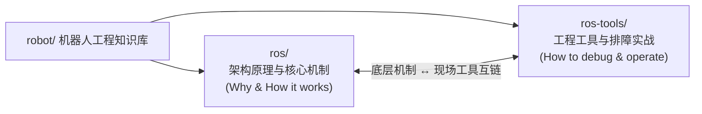

# 机器人工程知识库（Robot）

> [返回仓库总目录](../README.md)
>
> 本目录聚焦**工业级机器人与 ROS 2 工程研发**，采用“**底层原理 × 实战工具**”双轨并行的组织方式：既能自底向上吃透通信栈与运行机制，也能在日常开发与真机联调中快速检索命令、配置与排障手段。

---

## 目录导航

| 模块 | 核心定位 | 适合场景 |
| :--- | :--- | :--- |
| **[ros/](ros/README.md)** | **ROS 2 架构设计与核心机制**（6 层架构深潜） | 理解 `rclcpp`/`rcl`/`rmw`/DDS/Zenoh 原理、QoS、Executor 并发调度、零拷贝与 `.dsv` 构建加载机制。 |
| **[ros-tools/](ros-tools/README.md)** | **ROS 2 与机器人行业工具实战手册**（7 大工具域） | 日常命令行参数速查、数据录播（MCAP）、可视化（RViz2/Foxglove/PlotJuggler）、TF2/URDF 调试、网络/性能排障与真机生态工具。 |

