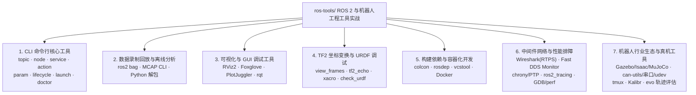

# ROS 2 与机器人行业工具实战指南（ROS Tools）

> [返回机器人目录总览](../README.md) | [切换至 ROS 2 架构原理 (`../ros/`)](../ros/README.md)
>
> 本目录面向**机器人 C/C++ 与系统集成工程师**，以 **ROS 2 Humble / Jazzy** 为基准（关键版本差异将显式标注），系统沉淀日常开发、数据回放、三维可视化、网络排障与真机落地中的高频工具。
> 组织方式延续仓库的**三步递进法**：
> 1. **全局总纲（本文档）**：建立工具全景地图、按排障场景快速定位工具，并完成 ROS 1 → ROS 2 命令迁移；
> 2. **模块细节大纲（各工具域 `README.md`）**：梳理每个工具域的核心子命令、高频参数骨架、典型坑点与思考题；
> 3. **专题手册深潜（各模块子文档）**：按需针对高频工具展开完整参数速查表、可直接复制的命令模板与配置文件范例。

---

## 一、工具全景架构图

---

## 二、按工程排障场景快速索引

遇到现场问题不知道该用什么工具时，可按以下场景直达对应模块：

| 现场典型问题 / 诉求 | 首选工具组合 | 对应模块 |
| :--- | :--- | :--- |
| **节点起来了但收不到消息 / 怀疑 QoS 不匹配** | `ros2 topic info -v`、`ros2 node info`、`ros2 doctor`、`ros2 daemon stop` | [1. CLI 命令行核心工具](1.%20CLI命令行核心工具/README.md) |
| **需要录包复现故障、裁剪 GB 级大包或提取 CSV** | `ros2 bag record/play`、`mcap filter/info`、`rosbags` | [2. 数据录制回放与离线分析](2.%20数据录制回放与离线分析/README.md) |
| **本地 3D 调试 / 远程低带宽看真机 / 分析高频控制曲线** | `RViz2`、`Foxglove Studio`（+ `foxglove_bridge`）、`PlotJuggler`、`rqt_graph` | [3. 可视化与GUI调试工具](3.%20可视化与GUI调试工具/README.md) |
| **TF 报 `extrapolation` / 树断裂 / 机械臂关节方向反向** | `view_frames`、`tf2_echo`、`tf2_monitor`、`check_urdf`、`joint_state_publisher_gui` | [4. TF2坐标变换与URDF模型调试](4.%20TF2坐标变换与URDF模型调试/README.md) |
| **多包增量编译慢 / 缺依赖 / 环境隔离与容器透传** | `colcon build --packages-up-to`、`rosdep`、`vcs`、`Docker` | [5. 构建依赖与容器化开发工具](5.%20构建依赖与容器化开发工具/README.md) |
| **多机发现失败 / 图像丢帧 / 回调延迟飙升 / C++ 节点段错误** | `Wireshark (rtps)`、`Fast DDS Monitor`、`chrony/ptp4l`、`ros2_tracing`、`GDB` | [6. 中间件网络与性能排障工具](6.%20中间件网络与性能排障工具/README.md) |
| **仿真验证 / 查底盘 CAN 报文 / 串口防漂移 / 标定与轨迹打分** | `Gazebo / Isaac Sim / MuJoCo`、`can-utils`、`udev`、`tmux`、`Kalibr`、`evo` | [7. 机器人行业生态与真机工具](7.%20机器人行业生态与真机工具/README.md) |

---

## 三、ROS 1 → ROS 2 高频命令速查对照表

| 工程动作 | ROS 1 | ROS 2（Humble / Jazzy） | 关键变化说明 |
| :--- | :--- | :--- | :--- |
| 查看节点/话题/服务 | `rosnode` / `rostopic` / `rosservice` | `ros2 node` / `ros2 topic` / `ros2 service` | 统一收口至 `ros2` 插件化 CLI，无 `roscore`。 |
| 查看消息/服务定义 | `rosmsg show` / `rossrv show` | `ros2 interface show` | 消息、服务、动作定义统一归口到 `interface`。 |
| 读写与导出参数 | `rosparam get/set/dump` | `ros2 param get/set/dump <node>` | 参数归属单个节点自治，操作必须指定目标节点名。 |
| 运行节点并重映射 | `rosrun pkg exe __name:=n /a:=/b _p:=1` | `ros2 run pkg exe --ros-args -r __node:=n -r a:=b -p p:=1` | 所有 ROS 专属参数必须放在 `--ros-args` 之后。 |
| 启动编排文件 | `roslaunch pkg file.launch` | `ros2 launch pkg file.launch.py` | 支持 Python / XML / YAML，且支持 `--show-args` 预览入参。 |
| 录制与回放数据包 | `rosbag record` / `rosbag play` | `ros2 bag record` / `ros2 bag play` | 存储后端全面转向 `MCAP`（Jazzy 默认，Humble 建议显式 `-s mcap`）。 |
| 查看 TF 坐标树 | `rosrun tf2_tools view_frames.py` | `ros2 run tf2_tools view_frames` | 去掉 `.py` 后缀，生成当前目录 `frames_*.pdf`。 |
| 静态坐标发布 | `static_transform_publisher x y z y p r f c` | `ros2 run tf2_ros static_transform_publisher --x ... --frame-id f --child-frame-id c` | 新版强烈推荐具名参数，彻底避免欧拉角顺序混淆。 |
| 系统健康自检 | `roswtf` | `ros2 doctor`（别名 `ros2 wtf`） | 检查网络配置、RMW、包版本与未匹配 QoS。 |

---

## 四、工具模块导航与进度规划

- **1. [CLI 命令行核心工具](1.%20CLI命令行核心工具/README.md)**：`ros2` 全系列子命令骨架、通用 `--ros-args` 语法、`topic/node/service/action/interface/param/lifecycle/component/run/launch/daemon/doctor/control` 核心参数与避坑指南。
- **2. [数据录制回放与离线分析](2.%20数据录制回放与离线分析/README.md)**：`ros2 bag`（MCAP）录播参数与 QoS 覆写、`mcap` 独立 CLI 裁剪合并、Python 免 ROS 离线解包。
- **3. [可视化与 GUI 调试工具](3.%20可视化与GUI调试工具/README.md)**：`RViz2`、`Foxglove Studio`（含 `foxglove_bridge`）、`PlotJuggler` 与 `rqt` 工具集选型与高频排坑。
- **4. [TF2 坐标变换与 URDF 模型调试](4.%20TF2坐标变换与URDF模型调试/README.md)**：TF 树诊断三件套、`static_transform_publisher`、`xacro` / `check_urdf` 与关节可视化校验。
- **5. [构建、依赖与容器化开发工具](5.%20构建依赖与容器化开发工具/README.md)**：`colcon` 增量编译与 `clangd` 联动、`rosdep`、`vcstool (vcs)` 与机器人 Docker 容器透传配置。
- **6. [中间件、网络与性能排障工具](6.%20中间件网络与性能排障工具/README.md)**：`Wireshark (rtps)`、`Fast DDS Monitor`、`chrony/PTP` 多机时间同步、`ros2_tracing` 与 GDB/perf 节点调试。
- **7. [机器人行业生态与真机工具](7.%20机器人行业生态与真机工具/README.md)**：三大主流仿真器（Gazebo / Isaac Sim / MuJoCo）、真机硬件调试（`can-utils` / 串口 / `udev` / `tmux`）以及标定与轨迹评估（`Kalibr` / `evo`）。
