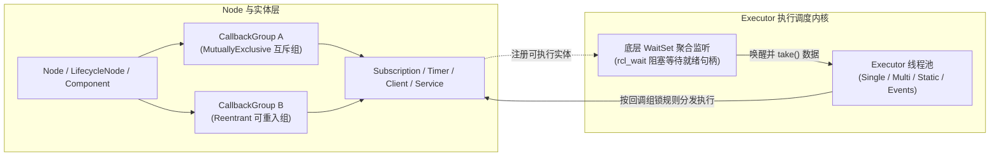

# 第 1 层：应用与客户端库层（`rclcpp` / Client Library Layer）

> [返回 ROS 2 架构总纲](../README.md)
>
> **本层核心定位**：C++ 开发者日常直接打交道的面向对象编程接口层。相比 ROS 1 的 `roscpp`，`rclcpp` 不再直接实现底层协议，而是专注于**现代 C++ 资源所有权管理、组件化动态装载、生命周期状态机编排，以及基于执行器（Executor）与回调组（Callback Group）的细粒度并发调度**。

---

## 一、从 `roscpp` 到 `rclcpp` 的核心架构演进

* **告别全局状态单例**：ROS 1 的 `ros::init()` 和全局 `NodeHandle` 强绑定进程级全局状态；`rclcpp` 将上下文封装为 `rclcpp::Context`，同一进程可安全实例化多个互不干扰的 `Node`，为组件化容器与单元测试奠定基础。
* **节点内部接口模块化（Node Interfaces）**：`rclcpp::Node` 内部拆解为 10+ 个细粒度子接口（`NodeBaseInterface`、`NodeTopicsInterface`、`NodeGraphInterface`、`NodeTimersInterface` 等），使普通 `Node` 与 `LifecycleNode` 能够以非继承耦合的方式共享算法模板代码。
* **并发控制显式化**：从 ROS 1 粗放的 `CallbackQueue` + `AsyncSpinner`，演进为 **`Executor` + `WaitSet` + `CallbackGroup`** 三级调度模型。

---

## 二、本层核心机制细节大纲

### 1.1 多语言封装体系与 `rclcpp` 对象模型
* **客户端库家族分工**：`rclcpp`（C++17 主力业务/算法）、`rclpy`（Python 快速原型/编排工具）、`rclc`（纯 C 确定性调度，面向 micro-ROS MCU）。
* **智能指针与生命周期安全**：全面采用 `SharedPtr` / `WeakPtr` / `UniquePtr`（宏 `RCLCPP_SMART_PTR_DEFINITIONS`），结合回调捕获时的生命周期防悬空设计。

### 1.2 三大核心节点形态与进程内零拷贝
* **普通节点（`rclcpp::Node`）**：常规独立进程开发载体，启动即进入活跃收发状态。
* **生命周期节点（`rclcpp_lifecycle::LifecycleNode`）**：
  * **4 个主状态**：`Unconfigured`（未配置）→ `Inactive`（已分配资源但暂停收发数据）→ `Active`（全功能运行）→ `Finalized`（彻底销毁）。
  * **6 个过渡态与回调钩子**：`on_configure()`、`on_activate()`、`on_deactivate()`、`on_cleanup()`、`on_shutdown()`、`on_error()`。
  * **中台管控原理**：每个 LifecycleNode 自动暴露 `/<node>/change_state`、`/get_state` 服务与 `/transition_event` 话题，供总控节点按严格依赖顺序编排启停与故障降级。
* **组件化（Component / Composition）与进程内通信（Intra-Process）**：
  * **编译与运行解耦**：使用 `RCLCPP_COMPONENTS_REGISTER_NODE` 将节点编译为 `.so` 动态库，运行期通过服务调用动态加载/卸载进 `component_container`（单线程）或 `component_container_mt`（多线程）。
  * **进程内零拷贝原理**：开启 `NodeOptions().use_intra_process_comms(true)` 后，发布 `std::unique_ptr<MsgT>` 直接投入进程内无锁环形缓冲区（`IntraProcessManager`），绕过 `rcl`/`rmw`/DDS 序列化，实现纯内存指针移交（1 对 1 转移 `unique_ptr`，1 对 N 自动退化为 `shared_ptr` 只读共享）。

### 1.3 并发执行器（Executor）与回调组（Callback Group）调度机制
* **四大 Executor 底层差异与性能特征**：
  * `SingleThreadedExecutor`：单线程顺序轮询，每次循环动态重建 `WaitSet`（早期版本存在高频 CPU 开销）。
  * `StaticSingleThreadedExecutor`：针对拓扑固定节点优化，仅在实体增删时重建 `WaitSet`，降低调度开销。
  * `MultiThreadedExecutor`：内部维护线程池并发拉取就绪任务，**必须配合 Callback Group 才能真正释放并行能力**！
  * `EventsExecutor`（Iron/Jazzy 重点演进）：抛弃传统阻塞 `WaitSet` 轮询，改由底层中间件接收线程直接往无锁事件队列推入就绪事件，显著降低 CPU 空转与唤醒延迟。
* **Callback Group 并发隔离与防死锁法则（中台必考）**：
  * **默认陷阱**：节点若不显式创建回调组，所有 Subscription / Timer / Service / Client **默认全部归属同一个默认 `MutuallyExclusive`（互斥）回调组**——此时即便换用 `MultiThreadedExecutor`，同一节点的两个回调也**绝不会并行执行**！
  * **`MutuallyExclusive`（互斥组）**：组内任意时刻最多 1 个回调在跑（适合保护共享状态而无需手写业务锁；可将高频控制环与低频耗时任务拆入两个独立互斥组实现互不阻塞）。
  * **`Reentrant`（可重入组）**：允许多个线程同时进入同一回调的不同实例，或并行执行同组内不同回调（高吞吐中台网关常用，业务需自行保证共享变量线程安全）。
* **确定性饥饿问题（Executor Starvation）**：剖析经典 `WaitSet` 检查优先级顺序（Timer → Subscription → Service → Client → Waitable）在极端高负载下可能引发低优先级实体饥饿的原理。

### 1.4 定时器（`Timer`）与内部唤醒机制（`GuardCondition`）
* **`WallTimer` vs `GenericTimer`**：为什么 `create_wall_timer` 强制绑定 `SteadyClock`（不受仿真倍速 `/clock` 影响），而在 Gazebo 仿真中必须使用绑定节点 ROS Clock 的 `create_timer`？
* **`GuardCondition`（守护条件）**：ROS 2 跨线程唤醒 `WaitSet` 的最小原子信号（类似 Linux `eventfd`），支撑 `rclcpp::shutdown()`、进程内通信通知与异步图变更唤醒。

---

## 三、工程排障与深度思考题（进入 Step 3 前的检验清单）

1. **为什么把 `SingleThreadedExecutor` 直接改成 `MultiThreadedExecutor`，节点里的 100Hz 控制定时器还是被一个耗时 500ms 的图像回调卡住了？最少改几行代码能修好？**
2. **在开启 `use_intra_process_comms(true)` 后，如果代码里写的是 `pub->publish(msg)`（传左值引用）而不是 `pub->publish(std::move(unique_msg))`，还会是零拷贝吗？底层发生了几次拷贝？**
3. **`LifecycleNode` 处于 `Inactive` 状态时，`LifecyclePublisher` 调用 `publish()` 会报错还是静默丢弃？此时订阅回调还能收到消息吗？**

---

## 四、后续 Step 3 专题深潜规划

- 📂 `1.1 节点形态与组件化零拷贝/`：深入 `NodeInterfaces` 设计、手写 Lifecycle 状态机故障自愈与 `IntraProcessManager` 智能指针流转源码剖析。
- 📂 `1.2 执行器与回调并发调度/`：拆解 `Executor::spin()` 源码循环、复现典型回调死锁现场并对比 `WaitSet` 与 `EventsExecutor` 延迟表现。
- 📂 `1.3 定时器与内部事件唤醒机制/`：剖析仿真时间下 `Timer` 唤醒实现与自定义 `Waitable` 接入外部异步 I/O（如 Boost.Asio / Socket）。
