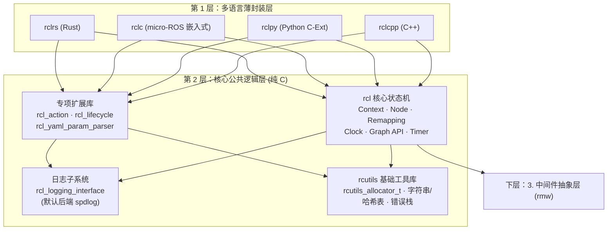

# 第 2 层：核心公共逻辑层（`rcl` & `rcutils`）

> [返回 ROS 2 架构总纲](../README.md)
>
> **本层核心定位**：ROS 2 客户端体系的**纯 C 语言底座**。它向上为 C++（`rclcpp`）、Python（`rclpy`）、Rust（`rclrs`）及嵌入式 C（`rclc`）提供行为完全一致的 ROS 核心语义，向下调用第 3 层 `rmw` 接口，并利用 `rcutils` 提供硬实时友好的内存分配、基础数据结构与统一日志设施。

---

## 一、为什么 ROS 2 必须单独抽出一层纯 C 的 `rcl`？

在 ROS 1 中，`roscpp`（C++）和 `rospy`（Python）是两套完全独立开发的客户端栈，连底层 `TCPROS` 握手、话题重映射语法（Remapping）、参数解析与时钟逻辑都各写了一遍，长期存在大量“C++ 节点表现正常、Python 节点行为不一致”的隐蔽 Bug。

ROS 2 引入 **`rcl`（ROS Client Library in C，遵循 C11 标准）** 解决了三大工程问题：
1. **一处实现、多语言同构**：节点命名校验、命令行重映射（`--ros-args -r`）、时钟跳变回调、参数路径规则与 Service/Action 状态机全部收敛在 `rcl`；各语言只需用 FFI / C 扩展做极薄的惯用语法包装（Skinny Wrapper）。
2. **零 C++ 运行时负担与 ABI 稳定**：纯 C 接口具备极佳的跨编译器 ABI 稳定性，方便 Rust、Go、C# 等任意现代语言直接绑定。
3. **打通微控制器（MCU）端**：运行在 FreeRTOS / Zephyr 上的 **micro-ROS（`rclc`）** 直接复用同一套 `rcl` 核心数据结构，仅将动态内存重型调度替换为嵌入式静态执行器。

---

## 二、本层核心机制细节大纲

### 2.1 `rcl` 核心上下文与统一命令行规则引擎
* **`rcl_context_t` 去全局化设计**：保存单次初始化生命周期内的全局命令行参数（`rcl_arguments_t`）、底层 `rmw_context_t` 句柄与关停状态原子计数。
* **统一命令行解析与重映射（Remapping）引擎**：
  * 解析 `--ros-args -r __node:=my_node -r chatter:=/sensor/chatter -p freq:=50.0 --params-file cfg.yaml`。
  * 全部在 `rcl` 层统一完成名称展开（局部名 `topic`、相对名 `sub/topic`、全局名 `/topic`、私有命名空间 `~/topic`），确保任何语言编写的节点拥有 100% 一致的重映射与参数覆盖优先级。

### 2.2 基础工具与硬实时自定义内存管理（`rcutils` & Allocator）
* **为什么硬实时（Hard Real-Time）控制环严禁直接 `malloc` / `new`？**
  * 标准系统堆分配器存在锁竞争、内存碎片整理与缺页异常（Page Fault），会导致不可预测的毫秒级毛刺。
* **可注入分配器契约（`rcutils_allocator_t`）**：
  * 定义 `allocate`、`deallocate`、`reallocate`、`zero_allocate` 函数指针结构体与 `state` 上下文指针。
  * 从上层 `rclcpp`（结合 C++ `std::allocator_traits` / PMR 多态内存池如 TLSF 双层隔离适配分配器）一路透传经 `rcl` 直达 `rmw`，支持在节点 `Startup` 阶段预分配固定内存池，进入 `Active` 实时循环后实现**零动态堆内存申请**。
* **线程局部错误栈（Thread-Local Error Handling）**：C 语言无异常机制，`rcutils` 通过 TLS（Thread-Local Storage）维护 `rcutils_set_error_state` 错误消息链，在转换成 C++/Python 异常时完整保留底层报错文件与行号。

### 2.3 无中心通信图谱自省（Graph API）
* **拓扑查询接口族**：`rcl_get_node_names`、`rcl_get_topic_names_and_types`、`rcl_count_publishers` / `rcl_count_subscribers`、`rcl_get_publishers_info_by_topic`（含对端节点名、类型与实际生效的 QoS Profile！）。
* **事件驱动的图变更感知**：摒弃轮询，上层可通过节点自带的 `graph_guard_condition` 阻塞等待远端节点上下线事件（例如发布者在确认下游至少有 1 个订阅者上线后再发送关键初始化指令）。

### 2.4 三类时钟抽象（Clock & Time Source）
* **`RCL_SYSTEM_TIME`（系统实时钟）**：对应 `CLOCK_REALTIME`（Unix 纪元墙上时间），会受 NTP 网络校时发生**时间回拨或突变**，适合打跨机对齐的业务日志时间戳，**绝不可用于计算控制周期差值或超时等待**！
* **`RCL_STEADY_TIME`（单调稳定钟）**：对应 `CLOCK_MONOTONIC`，自开机起严格单调递增、不受校时干扰，专用于耗时统计、超时控制与硬件看门狗。
* **`RCL_ROS_TIME`（ROS 逻辑时钟）**：
  * 默认未激活 `use_sim_time` 时等价于 `RCL_SYSTEM_TIME`；
  * 当节点参数 `use_sim_time := true` 时，自动切换为订阅 `/clock` 话题驱动！支持 Gazebo 慢放（0.2x）、超实时快进（10x）或 `rosbag2` 暂停单步调试，且支持注册 `rcl_clock_add_jump_callback` 监听回放拖拽引起的时间跳变以重置滤波器（如 EKF/TF 缓存）。

### 2.5 可插拔分级日志架构（`rcl_logging`）
* **三级输出分流**：① 标准控制台流（stdout/stderr 格式化染色）→ ② 本地高速落盘（默认集成 **`rcl_logging_spdlog`**，写入 `~/.ros/log/`）→ ③ 网络广播流（发布至 `/rosout` 话题供远程 `rqt_console` 监控，高负载下可通过 `--ros-args --disable-rosout-logs` 关闭以节省带宽）。
* **动态日志级别热调节**：运行期无需重启节点，支持通过内置日志服务动态把某一个特定子模块从 `INFO` 调为 `DEBUG`。

---

## 三、工程排障与深度思考题（进入 Step 3 前的检验清单）

1. **回放 `rosbag2` 数据包调试定位算法时，忘记给算法节点加 `--ros-args -p use_sim_time:=true`，或者包回放到一半重新从头播放（时间倒流），TF 查询和滤波器会发生什么故障？`JumpCallback` 如何优雅处理它？**
2. **机器人遇到 NTP 校时导致系统时间向前跳变了 5 秒，如果底层控制环超时检测误用了 `RCL_SYSTEM_TIME` 而不是 `RCL_STEADY_TIME`，会发生什么危险后果？**
3. **高并发节点每秒疯狂打印上万条 `RCLCPP_INFO` 为什么会严重拖慢业务主线程甚至挤占 DDS 带宽？从 `rcl_logging` 三个输出通道该如何针对性裁剪？**

---

## 四、后续 Step 3 专题深潜规划

- 📂 `2.1 rcl核心状态机与重映射规则/`：走读 `rcl_init` / `rcl_node_init` 与 `--ros-args` 名称解析实现。
- 📂 `2.2 通信图谱自省_GraphAPI实战/`：编写无轮询等待对端就绪与在线巡检全网 QoS 匹配的诊断节点。
- 📂 `2.3 时钟体系、实时内存分配器与日志优化/`：实战基于 TLSF 自定义 Allocator 的零 `malloc` 实时节点验证，以及仿真时钟跳变回调处理。
