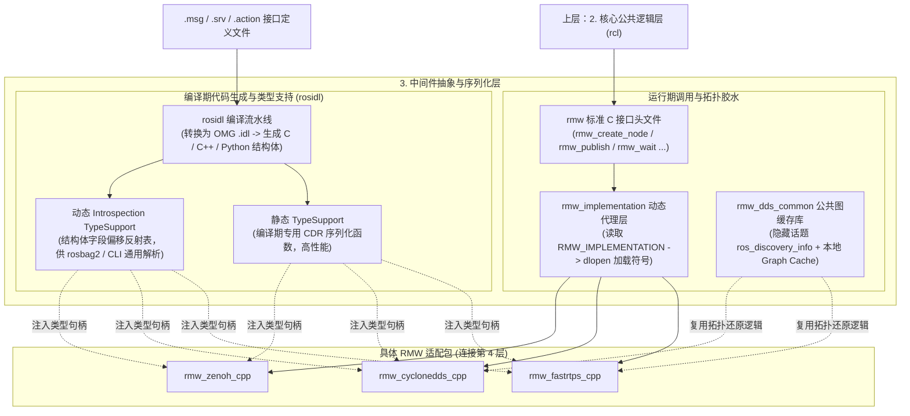

# 第 3 层：中间件抽象与序列化层（`rmw` & `rosidl`）— 中间件上篇

> [返回 ROS 2 架构总纲](../README.md)
>
> **本层核心定位**：连接“ROS 2 语义世界（`rcl`）”与“外部通信中间件世界（DDS / Zenoh）”的**胶水与翻译层**。它回答三个核心问题：
> 1. 上层 C++ 代码如何在**不重编**的前提下动态切换不同厂商的中间件？
> 2. 没有 `roscore` 时，底层松散的中间件读写端点是如何还原成上层“哪个节点开了哪些话题/服务”拓扑图的？
> 3. 自定义 `.msg/.srv/.action` 是如何变成内存结构体并序列化为网络字节流的？

---

## 一、架构边界与对比 ROS 1 的结构跃迁

在 ROS 1 中，序列化引擎（`genmsg` + `roscpp_serialization`）与传输协议（`TCPROS`/`UDPROS`）全部硬编码在 `roscpp` 内部，无法替换底层传输库。ROS 2 将其拆解为两个正交子系统：**运行期接口抽象（`rmw`）** 与 **编译期/运行期类型系统（`rosidl`）**。

---

## 二、本层核心机制细节大纲

### 3.1 RMW 接口设计与运行期动态切换机制
* **`rmw` 纯 C 抽象契约**：
  * 核心原语边界：初始化上下文（`rmw_context_t`）、节点句柄、发布者/订阅者、服务端/客户端、等待集（`rmw_wait_set_t` + `rmw_wait`）、零拷贝借用接口（`rmw_borrow_loaned_message`）与 QoS 转换。
  * 设计取舍：仅暴露各家中间件的“最大公约数”，厂商独有高级特性需下沉到第 4 层原生配置文件（XML / JSON5）。
* **`rmw_implementation` 动态加载机制**：
  * **单实现直链 vs 多实现动态代理**：当系统只安装了唯一 RMW 时可直接链接；安装多个 RMW 时，`librmw_implementation.so` 作为代理桩库，在进程启动期通过 `rcpputils::SharedLibrary`（底层 `dlopen` + `dlsym`）按符号表转发所有 `rmw_*` 函数指针。
  * **优先级决策链**：环境变量 `RMW_IMPLEMENTATION` → 编译期默认宏（如 Humble/Jazzy 默认 `rmw_fastrtps_cpp`）→ 已安装的候选实现回退。
  * **约束认知**：同一进程启动后不可热切换 RMW；跨进程通信通常要求处于兼容的有线协议族（如遵循标准 RTPS 的 Fast DDS 与 Cyclone DDS 基础通信可互通，但共享内存 SHM 与 `rmw_zenoh` 不跨协议互通）。

### 3.2 ROS 实体到中间件实体的映射与无中心图缓存
* **`Context / Node` ↔ `DomainParticipant` 映射演进（关键性能折点）**：
  * **早期模型（`1 Node = 1 Participant`）**：每个 ROS 节点独占一个 DDS `DomainParticipant`，导致同机多节点或 Component 容器内端口耗尽、发现报文呈平方级膨胀、内存暴涨。
  * **现代模型（`1 Context = 1 Participant`）**：同一个 `rcl_context_t`（通常对应一个 OS 进程）共享**唯一**一个底层 `DomainParticipant`，进程内的多个 `rclcpp::Node` 只是逻辑命名实体，共享底层网络套接字与发现线程。
* **ROS 通信原语的底层话题命名修饰（Topic Name Mangling）**：
  * 为避免原生 DDS 话题与 ROS 系统话题冲突，RMW 默认添加二级前缀：普通话题 `rt/<topic>`、服务请求 `rq/<srv>Request`、服务响应 `rr/<srv>Reply`、动作子通道 `rt/<action>/_action/feedback` 等（使用原生 DDS 互通时可通过 `avoid_ros_namespace_conventions` QoS 关闭前缀）。
* **`rmw_dds_common` 与无 Master 图拓扑还原机制**：
  * **核心问题**：既然多个 ROS `Node` 共享同一个 DDS `DomainParticipant`，远端节点只靠 DDS 标准发现协议（SPDP/SEDP）只能看到“某个 Participant 创建了某个 DataWriter”，根本不知道它归属于哪个 ROS 节点名和命名空间！
  * **解法剖析**：所有基于 DDS 的 RMW 共享 `rmw_dds_common` 库，在内部维护一个 `Transient Local + Reliable` 的隐藏系统话题 **`ros_discovery_info`**。每当进程内节点增删端点时，主动广播“Participant GUID ↔ ROS Node Name/Namespace ↔ Reader/Writer GID 映射表”，各节点在本地内存构建 **Graph Cache** 并触发 `graph_guard_condition` 唤醒上层 Graph API。

### 3.3 `rosidl` 编译流水线与 `TypeSupport` 序列化引擎
* **`rosidl` 多阶段编译流水线**：
  * 输入 `.msg` / `.srv` / `.action` → `rosidl_adapter` 统一转译为标准 **OMG IDL (`.idl`)** → 各语言生成器并行产出：
    * `rosidl_generator_c`：纯 C 结构体、初始化/销毁与数组内存管理函数；
    * `rosidl_generator_cpp`：现代 C++ 结构体、Builder 模式、特征萃取 traits（如 `has_bounded_size` / `is_pod`，决定能否走零拷贝！）；
    * `rosidl_generator_py`：Python 类 + C 扩展绑定，避免纯 Python 逐字节打包瓶颈。
* **双轨 `TypeSupport`（静态专用 vs 动态自省反射）**：
  * **静态类型支持（如 `rosidl_typesupport_fastrtps_cpp`）**：编译期为每个消息类型直接生成硬编码的序列化/反序列化 C++ 函数，业务节点收发消息零反射开销。
  * **动态自省类型支持（`rosidl_typesupport_introspection_c/cpp`）**：编译期生成描述每个字段“名称、基础类型、结构体字节偏移 `offsetof`、数组伸缩函数指针”的只读元数据表。**核心工程价值**：让 `rosbag2`、`ros2 topic echo`、网关桥接器无需在编译期 `#include` 具体业务头文件，即可在运行期动态解析任意消息！
  * **多类型支持分发器（Multi-TypeSupport Dispatcher）**：为什么同一份业务节点编译一次，就能既跑 Fast DDS 又跑 Cyclone DDS？因为 `rosidl_typesupport_cpp` 生成一张句柄映射表，运行期根据当前激活的 `RMW_IMPLEMENTATION` 标识符按需 `dlopen` 抽取对应中间件的专属 TypeSupport。
* **CDR（Common Data Representation）编码规则**：
  * 4 字节封装头（Encapsulation Header：标识大端/小端字节序与 CDR 版本）+ 严格按基础类型字节宽度对齐（Alignment Padding：如 `uint8` 后接 `uint64` 会填充字节）+ 动态序列（`sequence` / `string`）前置 4 字节长度前缀。

---

## 三、工程排障与深度思考题（进入 Step 3 前的检验清单）

1. **为什么同一个 Component 容器里放了 20 个节点，用 Wireshark 抓包却只看到 1 个 DDS `DomainParticipant`？此时 `ros2 node list` 是靠什么区分出 20 个节点的？**
2. **自定义 `.msg` 里如果调整了字段先后顺序（比如把 `uint8` 和 `float64` 交替排列 vs 同类聚合排列），对 CDR 序列化后的包体积和能否启用共享内存零拷贝（POD 判断）有什么影响？**
3. **`rmw_fastrtps_cpp` 与 `rmw_fastrtps_dynamic_cpp` 有什么本质区别？日常 C++ 业务开发应该用哪一个？**
4. **当公司内部有一个非 ROS 的原生 C++ DDS 程序想和 ROS 2 节点直接互通 Topic 时，需要对齐哪三件事（话题前缀、IDL 类型名修饰、CDR 封装）？**

---

## 四、后续 Step 3 专题深潜规划

当我们进入本层的具体机制讨论时，将按需创建以下专题子目录展开源码与实验分析：

- 📂 `3.1 RMW接口设计与运行期动态切换/`：剖析 `rmw_implementation` 的 `dlopen` 符号转发表与自定义轻量化 RMW 扩展原理。
- 📂 `3.2 ROS与中间件实体映射及图缓存机制/`：抓包实测 `ros_discovery_info` 报文结构与 `rmw_dds_common::GraphCache` 状态更新流程。
- 📂 `3.3 rosidl代码生成与TypeSupport序列化/`：拆解一个自定义 `.msg` 在 `build/` 与 `install/` 下生成的全套 C++ 头文件/符号表，手写验证 CDR 字节对齐与 Introspection 动态反射解析。
