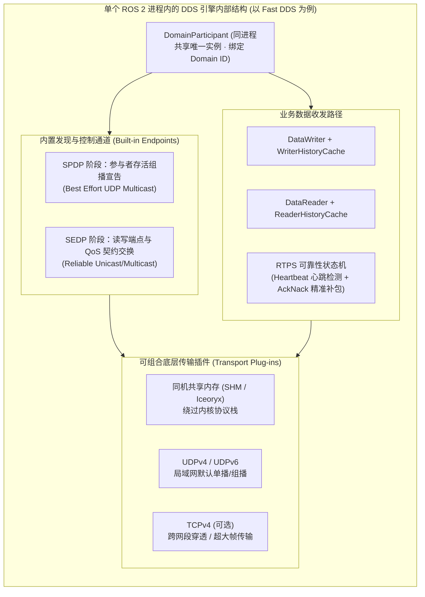

# 第 4 层：底层通信中间件与传输层（DDS / RTPS / Zenoh）— 中间件下篇

> [返回 ROS 2 架构总纲](../README.md)
>
> **本层核心定位**：ROS 2 分布式通信的**真正发动机**。剥开上层 ROS 包装后，所有的节点发现、可靠重传、流量控制、共享内存搬运与跨网路由全部发生在这里。理解本层是解决 ROS 2 **“连不上、丢大包、占内存、线程多、跨网难”** 五大生产顽疾的根本钥匙。

---

## 一、通信范式演进：从 ROS 1 `TCPROS` 到 DDS DCPS 与 Zenoh

* **ROS 1（以连接为中心）**：`roscore` 充当电话总机（XML-RPC），发布者与订阅者查号后建立点对点 **TCP 长连接（`TCPROS`）**，可靠性完全交给 Linux 内核 TCP 协议栈，一旦 Master 挂死新连接无法建立，且在弱网 Wi-Fi 下容易触发 TCP 队头阻塞（Head-of-Line Blocking）。
* **ROS 2 DDS（以数据为中心 DCPS）**：构建全局虚拟**全局数据空间（Global Data Space）**，默认跑在无连接的 **RTPS over UDP / SHM** 之上，把历史缓存（HistoryCache）与重传状态机上移到用户态中间件，由 **QoS 契约**按每个话题精细裁决可靠性与生命周期。
* **ROS 2 Zenoh（现代路由图模型）**：针对传统 DDS 在跨广域网、Wi-Fi 组播受限与大规模节点发现风暴下的短板，采用极简协议头与灵活拓扑（Peer / Client / Router）实现低开销发布订阅与查询。

---

## 二、本层核心机制细节大纲

### 4.1 DDS 核心模型（DCPS）、RTPS 有线协议与隐藏后台线程
* **DCPS（Data-Centric Publish-Subscribe）核心实体关系**：
  * `Domain`（逻辑隔离域）→ `DomainParticipant`（域参与者）→ `Publisher` / `Subscriber`（容器）→ **`DataWriter` / `DataReader`**（真正绑定 Topic 类型、持有 `HistoryCache` 队列并执行 QoS 控制的端点）。
* **RTPS 有线协议：如何在无连接 UDP 上实现 `Reliable` 可靠传输？**
  * 每个消息样本分配严格递增的序列号 **`SequenceNumber_t`**，首先写入发送端 `WriterHistoryCache`。
  * **正常推送 + 心跳确认闭环**：`DataWriter` 周期性或捎带发送 **`HEARTBEAT`** 子报文（通告当前缓存中最小/最大可用序列号）；`DataReader` 检查本地 `ReaderHistoryCache` 是否存在序列号空洞，回复 **`ACKNACK`** 位图报文（确认已收序列，或点名请求重传缺失序号）。
  * **关键推论**：DDS 的“可靠”不是无限重传，而是**受限于 `History` 策略（`KEEP_LAST(depth)` vs `KEEP_ALL`）**！若 `KEEP_LAST(5)` 下发送太快导致旧样本被新样本挤出 `WriterHistory`，即使开了 `Reliable` 订阅端也会永久丢帧！真正零丢包必须用 `Reliable + KEEP_ALL` 配合流控（Flow Controller）。
* **揭秘“隐藏后台线程模型”与数据收发路径**：
  * 为什么一个最简单的单线程节点在 Linux 下有 **6~10 个线程**？
    1. **组播发现监听线程**：监听 SPDP 元流量端口；
    2. **单播元数据监听线程**：处理 SEDP 端点握手与可靠重传信令；
    3. **单播业务数据接收线程**：从内核 Socket / SHM RingBuffer 抽取字节流、反序列化或校验后推入 `ReaderHistoryCache`，并触发上层 `WaitSet` 条件变量；
    4. **定时事件线程（TimedEvent）**：驱动周期性租约续期（Lease Duration）、Heartbeat 发送与 Deadline 超时检查；
    5. **异步发布线程（Async Publish Thread，开启异步模式或发大包分片时激活）**：后台切片与流量整形发送；
    6. **RMW 图监听线程**：消费 `ros_discovery_info` 更新本地 Graph Cache。
  * **Push vs Pull 边界**：底层网络线程将样本 **Push** 进 DDS `ReaderHistoryCache` 并唤醒 `rmw_wait()`，但**不会直接执行用户回调**；真正的业务消息是由上层 `rclcpp::Executor` 线程主动调用 `rmw_take()` **Pull（拉取）** 出来并在 Executor 线程执行回调！

### 4.2 自动发现机制与网络域隔离
* **两阶段自动发现协议（SPDP + SEDP）**：
  * **第一阶段 SPDP（Simple Participant Discovery Protocol）**：节点启动时向基于 `ROS_DOMAIN_ID` 计算出的标准 UDP 组播地址周期性广播自身身份、单播监听 IP:Port 列表与存活租约（Lease Duration，默认约 20s，超时未续租判定掉线）。
  * **第二阶段 SEDP（Simple Endpoint Discovery Protocol）**：双方 Participant 彼此认识后，通过**可靠单播**交换各自持有的全部 `DataWriter` / `DataReader` 元数据（Topic 名、Type 名、完整 QoS 参数），并在本地完成 RxO 匹配建链。
* **`ROS_DOMAIN_ID` 端口映射公式与范围限制**：
  * 端口号计算（默认 `domainIdGain = 250`，`offsetd0 = 7400`）：组播发现端口 = `7400 + 250 * domain_id`。
  * **为什么推荐 `ROS_DOMAIN_ID` 取值在 `0 ~ 101`（最大不超过 `232`）？** 因为超过后计算出的端口号会撞上 Linux 内核临时动态端口段（Ephemeral Ports：`32768 ~ 60999`）或越过 `65535` 上限导致节点启动偶发失败！
* **作用域收敛与“发现风暴”治理**：
  * `ROS_AUTOMATIC_DISCOVERY_RANGE`（Jazzy/Iron 引入，替代旧版生硬的 `ROS_LOCALHOST_ONLY`）：精确控制 `SUBNET`（默认子网组播）、`LOCALHOST`（仅本机）、`SYSTEM_DEFAULT` 或 `OFF`（配合 `ROS_STATIC_PEERS` 指定单播对端）。
  * **`O(N^2)` 发现风暴问题**：当系统中存在 $N$ 个 Participant 与 $M$ 个端点时，SEDP 匹配报文呈平方级增长，在 Wi-Fi 下极易打满带宽。**工程解法**：启用 Fast DDS **Discovery Server**（由全网两两广播退化为中心化/联邦式 `O(N)` 注册，但数据面依然保持点对点直连！）或切换 `rmw_zenoh`。

### 4.3 QoS 服务质量体系、RxO 匹配与大数据帧传输调优
* **七大核心 QoS 策略工程语义**：
  * `Reliability`（`RELIABLE` vs `BEST_EFFORT`）、`Durability`（`VOLATILE` vs `TRANSIENT_LOCAL` 替代 ROS 1 `latch` 为晚加入订阅者补发历史样本）、`History` + `Depth`、`Deadline`（周期断流告警）、`Lifespan`（过期脏数据自动丢弃）、`Liveliness`（节点存活心跳契约）。
* **Request vs. Offered（RxO）兼容性法则（高频排障点）**：
  * 核心原则：**发布者提供的服务等级（Offered）必须 $\ge$ 订阅者请求的服务等级（Requested）**，否则双方**静默拒绝建链（不抛异常、收不到任何数据）**！典型不兼容：`Best Effort` 发布者 $\times$ `Reliable` 订阅者；`Volatile` 发布者 $\times$ `Transient Local` 订阅者（可用 `ros2 topic info -v <topic>` 或 QoS 不兼容事件回调即时诊断）。
* **大数据帧（高分图像 / 激光点云）在默认 DDS 下的卡顿丢包机理与调优**：
  * **病因**：单帧点云达数 MB，远超 UDP 单包最大约 64KB 限制，RTPS 必须切分为数十个 UDP 分片（Fragments）。只要操作系统的默认内核接收缓冲（Linux `net.core.rmem_max` 默认常仅 208KB！）溢出丢掉其中 1 个分片，开启 `Reliable` 后整帧作废触发密集的 `AckNack` 重传风暴；若处于默认同步发布模式（`SYNCHRONOUS_PUBLISH_MODE`），甚至直接阻塞业务主线程的 `publish()`！
  * **四步根治方案**：① 同机优先走 **SHM 共享内存 / 零拷贝**；② 调大 Linux 内核 `rmem_max` / `wmem_max`（如 16MB~64MB）；③ 传感高频流视下游容忍度改用 `SensorDataQoS`（`Best Effort`）；④ 必须跨网可靠发大包时，通过 XML 开启 **异步发布模式（`ASYNCHRONOUS_PUBLISH_MODE`）+ 流量控制器（FlowController）**。

### 4.4 三级零拷贝（Zero-Copy）技术全景对比
| 层级方案 | 适用范围 | 核心机制 | 序列化开销 | 消息类型约束 |
| :--- | :--- | :--- | :--- | :--- |
| **1. `rclcpp` Intra-Process** | **同一进程内**（Component 容器或多节点同进程） | 绕过 `rcl`/`rmw`/DDS，直接在 C++ 层通过环形缓冲区移交 `std::unique_ptr<MsgT>` 所有权（一对多自动降级拷贝或共享 `shared_ptr`）。 | **0 次序列化、0 次拷贝** | 无限制（支持含 `std::string` / `std::vector` 的变长消息） |
| **2. DDS SHM Transport** | **同一物理机跨进程**（Fast DDS 默认自动启用） | 保留上层常规 `publish(msg)` API，仅将底层传输从 UDP Socket 替换为 POSIX 共享内存段，省去内核协议栈切换。 | **仍需 CDR 序列化 + 2 次内存拷贝**（用户结构体 $\to$ SHM $\to$ 接收端结构体） | 无限制 |
| **3. Loaned Message 真零拷贝** | **同一物理机跨进程**（Iceoryx / Fast DDS Data-Sharing） | 发布端调用 `borrow_loaned_message()` 直接在共享内存池上原地构造消息，中间件仅传递共享内存偏移指针，订阅端直接读取。 | **0 次序列化、0 次拷贝** | **严格要求定长 POD（Plain Old Data）类型**（禁止动态 `string`/`vector`，需用定长数组 `uint8[1024]`） |

### 4.5 主流中间件横评选型、厂商原生 XML 配置与异构生态
* **三大主流中间件架构选型对比**：
  * **Fast DDS（eProsima）**：ROS 2 官方默认，功能最全（自带 SHM、Data-Sharing、Discovery Server、详尽统计监控），但内部状态机庞大、默认参数在无线弱网下需精细调优。
  * **Cyclone DDS（Eclipse）**：C 语言编写，代码精炼、CPU 与内存占用低、局域网稳定性极佳；跨进程零拷贝通过外部集成 **Eclipse Iceoryx** 实现。
  * **Zenoh（`rmw_zenoh_cpp`）**：ROS 2 官方重点扶持的新一代非 DDS 实现。协议头极小（最低数字节）、默认基于 TCP/QUIC 或多路路由，**彻底消灭 UDP 组播依赖与 DDS 发现风暴**，天然支持跨公网/NAT 穿透、车云协同与 Wi-Fi 移动机器人集群。
* **生产环境“逃生舱”：厂商原生 XML 深度配置**：
  * RMW API 无法配置底层网络细节，工程部署通过环境变量挂载厂商原生配置文件：
    * Fast DDS：`FASTRTPS_DEFAULT_PROFILES_FILE=fastdds.xml`（配置网卡白名单 `interfaceWhiteList`、禁用组播单播 Peers、SHM 段大小、异步发送线程与重传速率限制）。
    * Cyclone DDS：`CYCLONEDDS_URI=file:///path/to/cyclonedds.xml`（绑定指定物理网卡、配置 Iceoryx 内存池与 Socket 缓冲）。
    * Zenoh：`ZENOH_ROUTER_CONFIG_URI` / `ZENOH_SESSION_CONFIG_URI`（JSON5 格式配置 Router 拓扑与桥接过滤规则）。
* **端侧微控制器与安全扩展**：
  * **micro-ROS（`Micro XRCE-DDS`）**：采用 **Client（MCU 端极简几 KB 内存占用，支持串口/CAN/UDP）↔ Agent（上位机网关进程）** 代理架构，由 Agent 代为在 DDS 域中注册镜像 `DataWriter`/`DataReader`。
  * **SROS2（DDS-Security）**：基于 X.509 PKI 证书链，通过 `enclave`（安全飞地）实现节点身份双向认证、AES-GCM 报文加密，以及 `governance.xml` + `permissions.xml` 细粒度控制“某节点只能发布 `/cmd_vel`，禁止篡改 `/tf`”。

---

## 三、工程排障与深度思考题（进入 Step 3 前的检验清单）

1. **为什么把 QoS 设为 `Reliable + KeepLast(1)` 并不能保证接收端收到每一条历史指令？什么配置才叫真正的“绝对不丢包”？代价是什么？**
2. **两台机器人连在同一个商场 Wi-Fi 下，明明设了不同的 `ROS_DOMAIN_ID` 互不干扰，但为什么机器一多网络还是卡爆了？（提示：路由器对 UDP 组播帧的底层空口降速广播机制）该如何用 XML 或 Zenoh 根治？**
3. **写 C++ 节点发送 4K 相机图像时，如果直接用 `sensor_msgs::msg::Image`（内部含 `std::vector<uint8_t> data`），能开启 `borrow_loaned_message()` 跨进程真零拷贝吗？如果不能，工程上该怎么定义消息结构？**
4. **为什么说 DDS 内部接收线程收到数据后只放进 `ReaderHistory` 而不直接跑用户的 C++ 回调函数？（结合线程安全与回调组调度思考）**

---

## 四、后续 Step 3 专题深潜规划

本层是中间件研究的主战场，后续将按需逐一建立以下专题目录进行抓包、配置实战与源码实验：

- 📂 `4.1 DDS核心模型与RTPS有线协议剖析/`：用 Wireshark 实测抓取 RTPS 的 `DATA`、`HEARTBEAT`、`ACKNACK` 报文，结合 `gdb`/`pstack` 拆解 Fast DDS 进程全线程栈。
- 📂 `4.2 节点自动发现机制与网络域隔离/`：推导 Domain ID 端口公式，实战对比默认组播 vs 单播白名单 vs Fast DDS Discovery Server 的流量开销。
- 📂 `4.3 QoS服务质量体系与大数据传输调优/`：完整推导 RxO 兼容性表，复现 10MB 点云丢包阻塞现场并完成内核参数 + XML 异步流控调优闭环。
- 📂 `4.4 进程内、共享内存与端到端零拷贝对比/`：编写 C++ Benchmark 实测对比常规发布、Component `unique_ptr`、Fast DDS SHM 与定长 `LoanedMessage` 的延迟与 CPU 开销。
- 📂 `4.5 主流中间件选型、XML深度配置与新兴生态/`：提供生产级 `fastdds.xml` / `cyclonedds.xml` 模板库，并实战测评 `rmw_zenoh` 路由拓扑与 SROS2 权限配置。
