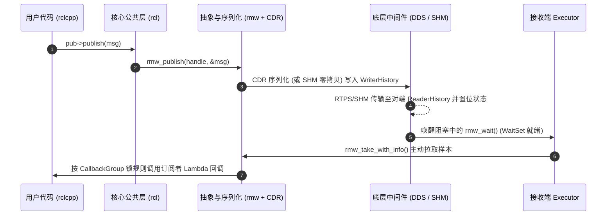

# 第 5 层：核心通信与协作机制（Communication & Coordination）

> [返回 ROS 2 架构总纲](../README.md)
>
> **本层核心定位**：**纵向贯穿第 1 ~ 4 层的端到端业务通信原语**。在理解了上层执行器（第 1 层）与底层中间件（第 3、4 层）后，本层将二者彻底串联，揭示 **Topic、Service、Action、Parameter、TF2** 五大核心机制在底层的真实协议映射、完整调用栈以及工程中最易踩坑的并发与时序边界。

---

## 一、五大通信与协作机制的底层本质映射表

在 ROS 2 中，**万物皆可归结为底层中间件的发布/订阅端点（DataWriter / DataReader）组合**：

| 上层机制 | 交互语义 | 底层中间件真实映射 | 典型业务场景 |
| :--- | :--- | :--- | :--- |
| **Topic（话题）** | 单向、异步、多对多持续数据流 | `1 DataWriter` ↔ `1 DataReader`（前缀 `rt/`） | 传感器高频流、底盘里程计、系统心跳上报 |
| **Service（服务）** | 双向、短耗时、一对一请求/响应 | **2 个隐式 Topic 对**：Request（`rq/`）+ Reply（`rr/`），通过 `SampleIdentity`（Client GUID + 递增序号）关联响应 | 瞬时状态查询、模式切换、硬件校准触发 |
| **Action（动作）** | 长耗时、有连续反馈、可取消/抢占的任务闭环 | **3 个 Service**（`send_goal`、`cancel_goal`、`get_result`）+ **2 个 Topic**（`feedback`、`status`） | 自主导航寻路、机械臂轨迹抓取、OTA 升级 |
| **Parameter（参数）** | 节点自治配置读写、原子校验与全局变更通知 | 每个节点自动内置 **6 个标准参数 Service** + **1 个全局广播 Topic（`/parameter_events`）** | 算法阈值热更新、开关动态切换 |
| **TF2（坐标变换）** | 分布式多坐标系有向无环树与时间序列插值 | **2 个全局汇聚 Topic**：`/tf`（`Volatile` 动态高频）+ `/tf_static`（`Transient Local` 持久化静态） | 雷达—相机—底盘—地图空间坐标实时转换 |

---

## 二、本层核心机制细节大纲

### 5.1 Topic（话题）：全链路数据流与事件回调
* **全栈生命周期**：梳理一次 `publish()` 到订阅端回调触发经过的每一次函数边界、内存分配点与线程切换点（发布者业务线程 → 可选异步发送线程 → 接收端中间件监听线程 → 接收端 Executor 工作线程）。
* **通信质量事件监听（QoS Events）**：不同于 ROS 1 的黑盒丢包，ROS 2 支持在 `PublisherOptions` / `SubscriptionOptions` 中挂载底层事件回调：`on_offered_deadline_missed`、`on_requested_deadline_missed`（上游传感器掉帧超时检测）、`on_message_lost`（中间帧丢失告警）、`on_incompatible_qos`（QoS 配错即时报警）。
* **内容过滤话题（Content-Filtered Topic）**：在订阅端下推过滤表达式（如 `"temperature > 80.0"`），若底层中间件（如 Fast DDS）支持则在**发送端直接过滤**，省去无效网络传输。

### 5.2 Service（服务）：底层本质与“回调内同步调用死锁”剖析
* **底层关联原理**：多个 Client 同时请求同一个 Server 时，Reply 话题是广播给所有 Client 的还是定向的？客户端是如何通过 RTPS `related_sample_identity` 精准认领属于自己的那条响应的？
* **头号工程陷阱：回调内部同步等待引发永久死锁**：
  * **复现现场**：在 `SingleThreadedExecutor`（或同一 `MutuallyExclusive` 回调组）的某个 Topic/Service 回调内部，调用 `auto result = client->async_send_request(req); future.wait();`。
  * **死锁机理**：当前回调霸占了唯一的执行线程（或互斥回调组锁）等待 `future` 完成；而服务端发回来的 Reply 报文虽然已经到达底层 DDS `ReaderHistory`，却需要**同一个 Executor / 同一个互斥回调组**去 `take()` 并执行响应回调来 `set_value` 唤醒 `future`——形成经典自锁！
  * **两大标准解法**：① **纯异步回调范式**（`async_send_request(req, callback)` 立即返回释放线程，推荐首选）；② **多线程执行器 + 独立回调组隔离**（将 `Client` 放入单独的 `MutuallyExclusive` 或 `Reentrant` 回调组，配合 `MultiThreadedExecutor`）。
* **请求超时与孤儿请求清理**：当 Server 崩溃未回包时，Client 端挂起的未完成请求（Pending Requests）会造成内存泄漏吗？如何使用 `prune_requests_older_than()` 安全回收？

### 5.3 Action（动作）：长耗时状态机组合协议
* **组合架构拆解**：为什么 ROS 2 不在 `rmw` 层新增一套原生 Action 接口，而是在 `rcl_action` 层用 `3 Services + 2 Topics` 组合实现？各子通道分别采用了什么 QoS 配置（如 `status` 话题为何采用 `Transient Local`）？
* **服务端与客户端双侧状态机**：
  * Goal 状态流转：`ACCEPTED` → `EXECUTING` → `CANCELING` → 终态（`SUCCEEDED` / `CANCELED` / `ABORTED`）。
  * 并发策略设计：新目标到达时是拒绝新目标、排队等待，还是立即抢占中止（Preempt）当前目标？长耗时执行线程与 Executor 线程如何分工避免阻塞心跳与取消请求？

### 5.4 Parameter（分布式参数）与原子校验机制
* **去中心化自治设计**：废弃全局 `rosparam` Master 字典，每个节点自行保管参数键值表（支持强类型：`bool`、`int64`、`double`、`string`、字节与数组，并通过 `declare_parameter` 强制显式声明）。
* **写入前拦截校验（Pre-set Validation Callback）**：通过 `add_on_set_parameters_callback` 在参数真正落地前执行合法性检查（例如拒绝负数 PID 增益或互斥参数组合），支持**原子事务回滚**（批量更新多个参数时，任一参数校验失败则整批拒绝生效）。
* **变更监听闭环**：`ParameterEventHandler` 如何订阅 `/parameter_events` 实现跨节点配置联动热更新。

### 5.5 TF2（多坐标系变换系统）与时间缓冲插值
* **`/tf` vs `/tf_static` 的 QoS 根源差异**：
  * 在 ROS 1 中 `/tf` 曾因高频重复广播静态外参浪费大量带宽，后来引入 latched `/tf_static`；
  * 在 ROS 2 中，`StaticTransformBroadcaster` 利用 **`Transient Local + KeepLast(depth)`** QoS 只在启动时发布一次静态外参，任何晚启动几十分钟的算法节点连上后都能由中间件自动补齐全部静态变换树！
* **`tf2_ros::Buffer` 时间环形队列与线性/球面插值（SLERP）**：
  * 为什么激光点云时间戳是 `t = 10.05s`，而底盘里程计 TF 分别在 `10.04s` 和 `10.06s`，`lookupTransform` 却能算出精确位姿？（平移向量线性插值 + 四元数 SLERP 球面线性插值，严禁跨越不同树分支超外推 Extrapolation）。
  * 配合 `tf2_ros::MessageFilter` 实现“点云消息到达后暂存，直到对应时刻的 TF 到齐再触发回调”的无报错同步模式。

---

## 三、工程排障与深度思考题（进入 Step 3 前的检验清单）

1. **在 `SingleThreadedExecutor` 节点里，绝对不能写 `rclcpp::spin_until_future_complete(node, future)` 的场景是什么？为什么教程里的 `main()` 函数这么写没报错，挪进回调函数里立马拉崩整个节点？**
2. **如果系统里有 10 个节点都往 `/tf_static` 发布静态坐标变换，而某个新订阅者把订阅 `/tf_static` 的 QoS 误写成了默认 `Volatile`（或者 `KeepLast(1)`），会出现什么诡异现象？**
3. **节点未调用 `declare_parameter("foo")` 就直接 `get_parameter("foo")` 为什么会抛异常？在动态插件场景下什么情况才需要开启 `allow_undeclared_parameters(true)`？**

---

## 四、后续 Step 3 专题深潜规划

- 📂 `5.1 Topic全链路源码追踪与QoS事件监控/`：从 `rclcpp::Publisher::publish` 一路跟到底层 RMW 唤醒，并实现传感器掉帧 Deadline 监控器。
- 📂 `5.2 Service死锁复现、异步范式与超时清理/`：编写最小死锁复现 Demo，对比纯异步 Lambda、C++20 协程封装与多回调组同步等待三种工程写法。
- 📂 `5.3 Action状态机抢占与中台任务编排/`：手写支持任务抢占、进度反馈与异常中断的工业级 Action Server 模板。
- 📂 `5.4 分布式Parameter热更新与TF2时间同步/`：实现带事务校验的动态调参模块，以及基于 `MessageFilter` 的传感器与 TF 精确时间戳对齐。
