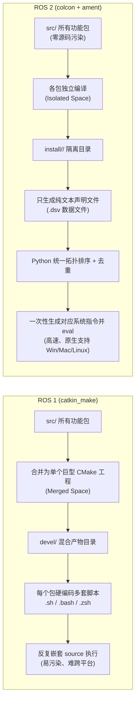
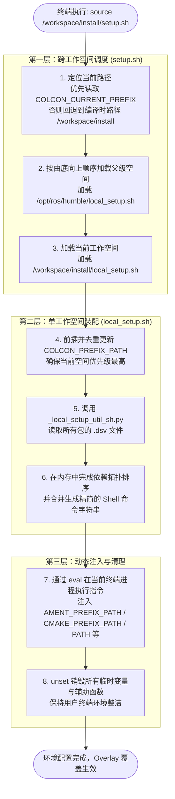
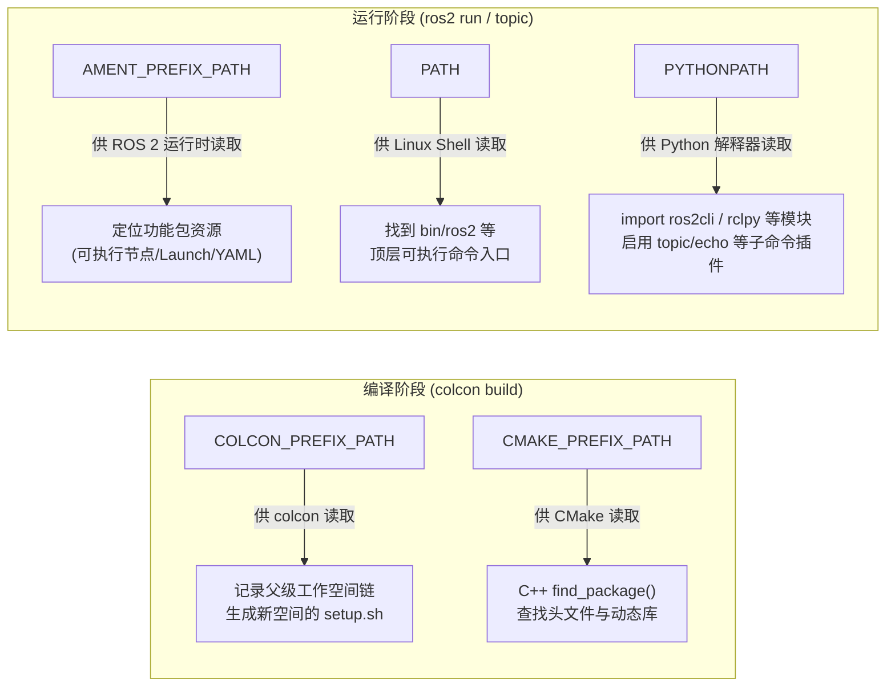

# ROS 2 环境加载机制与演进原理指南

> [返回第 6 层大纲](../README.md) | [返回 ROS 2 架构总纲](../../README.md)
>
> 本文档梳理了从 ROS 1 (`catkin_make`) 到 ROS 2 (`colcon` + `ament`) 的构建与环境配置机制演进，并结合实际编译产物（以 `/opt/ros/humble` 和 `/workspace/install` 为例），通过流程图直观拆解执行 `source install/setup.sh` 背后的完整底层原理。

---

## 第一部分：ROS 机制的演化（ROS 1 vs ROS 2）

在 ROS 1 时代，构建工具与 ROS 生态强绑定；而在 ROS 2 中，官方将**多包编排工具**（`colcon`）与**单包构建系统**（`ament`）彻底解耦，并从底层重构了环境变量的注入方式。

### 1.1 架构演进对比图

下面的流程图直观展示了 ROS 1 与 ROS 2 在编译产物组织与环境加载方式上的根本区别：



### 1.2 核心概念与环境变量演进对照表

如果你有 ROS 1 的使用经验，可以通过下表快速完成知识迁移：

| 维度 | ROS 1 (`catkin_make`) | ROS 2 (`colcon` + `ament`) | 演进原因与核心变化 |
| :--- | :--- | :--- | :--- |
| **工作空间链变量** | `CATKIN_PREFIX_PATH` | **`COLCON_PREFIX_PATH`** | 抛弃强耦合的 `catkin`，改用通用构建编排器 `colcon`（支持 CMake、Python 等多语言包），前缀链改由 `colcon` 管理。 |
| **运行时寻包变量** | `ROS_PACKAGE_PATH` | **`AMENT_PREFIX_PATH`** | 废弃直接扫描源码目录的做法，引入高效的资源索引机制（`ament_index`），运行时统一通过此变量定位包资源。 |
| **编译期依赖变量** | `CMAKE_PREFIX_PATH` | **`CMAKE_PREFIX_PATH`** | **保持不变**。底层 C++ 依赖查找依然由标准 CMake 的 `find_package()` 读取该变量。 |
| **编译产物隔离度** | 合并空间（`devel/`） | **隔离空间（`install/<pkg>/`）** | 默认每个功能包独立编译、独立安装，避免不同包的全局变量或依赖互相污染。 |
| **环境声明载体** | 硬编码 Shell 脚本 | **`.dsv` 纯文本配置文件** | 实现“数据与执行分离”，一套 `.dsv` 同时兼容 Linux/macOS/Windows，且大幅提升环境加载速度。 |

---

## 第二部分：ROS 2 环境加载的核心原理与流程

当你在终端执行 `source /workspace/install/setup.sh` 时，背后并不是简单的几条 `export` 命令，而是一套**“两级脚本调度 + Python 拓扑编排 + DSV 声明驱动”**的精密流水线。

### 2.1 全局执行流程图

以底层系统为 `/opt/ros/humble`、当前自定义工作空间为 `/workspace/install`（包含 `example_cpp` 包）为例，完整执行链路如下：



---

### 2.2 关键组件原理解析

#### 1. `setup.sh`：工作空间链（Workspace Chaining）的总调度器
* **核心职责**：解决“多工作空间叠加（Underlay / Overlay）”问题。
* **为什么能自动找到 `/opt/ros/humble`？**
  当你在终端执行 `colcon build` 时，`colcon` 会读取当前终端的 `COLCON_PREFIX_PATH`，记录下当时已经激活的所有父级工作空间，并将它们按顺序硬编码写入新生成的 `setup.sh` 中。
* **为什么先加载底层、再加载当前空间？**
  因为环境变量采用**前插（Prepend）**机制。先加载 `/opt/ros/humble`，再加载 `/workspace/install`，最终结果是 `/workspace/install` 排在搜索路径的最前面。这样如果你在当前空间重写了某个官方包，系统会优先使用你的修改版本（即 **Overlay 覆盖机制**）。
* **为什么需要 `COLCON_CURRENT_PREFIX`？**
  普通 POSIX Shell（`sh`）在被 `source` 时无法自动获知脚本自身的绝对路径。如果编译产物被移动到了新目录，只需提前设置 `COLCON_CURRENT_PREFIX=/new/path`，即可覆盖脚本里写死的编译期路径。

#### 2. `local_setup.sh`：单空间内的精密装配工
* **核心职责**：只负责加载**当前目录**下的所有功能包，不关心父级空间。
* **前插 + 去重机制（`_colcon_prefix_sh_prepend_unique_value`）**：
  每次向冒号分隔的环境变量（如 `COLCON_PREFIX_PATH`）添加路径时，函数会先把新路径放在最前面，再遍历旧路径并剔除重复项。这保证了无论你重复 `source` 多少次，环境变量都不会无限膨胀，且最新加载的路径永远拥有最高优先级。
* **为什么 Shell 脚本要调用 Python + `eval`？**
  * **痛点**：单个工作空间可能包含数百个存在复杂依赖关系的功能包（如 `pkg_B` 依赖 `pkg_A`），用纯 Shell 做拓扑排序极其困难且低效。
  * **解法**：委托给同目录下的 `_local_setup_util_sh.py` 计算拓扑顺序。由于 Python 运行在子进程中，无法直接修改当前终端的环境变量，因此 Python 只负责把最终的 `export` 语句作为文本输出，再由 `local_setup.sh` 使用 `eval` 在当前终端进程中动态执行。

#### 3. `.dsv` 文件：跨平台与高性能的秘密武器
* **全称**：Delimiter-Separated Values（分号分隔值文件）。
* **核心思想**：**数据与执行分离**。99% 的功能包不需要编写复杂的环境变量脚本，只需用纯文本声明“我要把哪个路径加到哪个变量里”。
* **语法结构**：以 `example_cpp` 包的 `ament_prefix_path.dsv` 为例，内容仅有一行：
  ```text
  prepend-non-duplicate;AMENT_PREFIX_PATH;
  ```
  * **第 1 列（动作）**：`prepend-non-duplicate`（前插去重）或 `source`（执行自定义脚本钩子）。
  * **第 2 列（目标变量）**：需要修改的环境变量名。
  * **第 3 列（相对路径）**：相对于当前包根目录的子路径（留空代表包根目录本身，填 `bin` 则代表 `<pkg_root>/bin`）。
* **三大收益**：
  1. **跨平台**：Linux 下由 `_local_setup_util_sh.py` 翻译成 `export`，Windows 下由 `_local_setup_util_bat.py` 翻译成 `set`，功能包本身零感知。
  2. **高性能**：Python 一次性解析所有 `.dsv` 并在内存中去重，大幅减少终端启动耗时。
  3. **保留扩展性（Hook）**：遇到必须执行复杂逻辑的特殊包，仍可在 `.dsv` 中通过 `source;share/<pkg>/hook/xxx.sh` 挂载自定义脚本。

---

### 2.3 核心环境变量分工图谱

理解以下 5 个环境变量的各自职责，就能彻底理清 ROS 2 编译与运行的底层逻辑：



> **典型场景辨析：当你敲下 `ros2 topic echo /chatter` 时发生了什么？**
> 1. 终端先通过 **`PATH`** 找到 `/opt/ros/humble/bin/ros2` 这个入口程序；
> 2. `ros2` 启动 Python 解释器，通过 **`PYTHONPATH`** 找到并导入 `ros2cli`、`ros2topic` 等插件模块，从而识别 `topic` 和 `echo` 子命令；
> 3. 如果涉及特定功能包的消息类型或资源，ROS 2 则通过 **`AMENT_PREFIX_PATH`** 定位到对应的包安装目录。

---

## 第三部分：日常使用与调试速查

### 3.1 `setup.bash` vs `setup.sh` vs `local_setup.sh` 选型指南

| 脚本文件 | 适用场景 | 核心区别 |
| :--- | :--- | :--- |
| **`setup.bash`** | **日常终端开发首选**（Bash 环境） | 内部调用 `setup.sh`，并额外加载了 Bash 专属的 **Tab 键命令自动补全**功能。 |
| **`setup.sh`** | Dockerfile、CI/CD 脚本、极简容器 | 严格遵循 POSIX 标准，兼容性最强，但不包含 Tab 补全。 |
| **`local_setup.sh`** | 仅需隔离加载当前工作空间时 | **只加载当前目录**的功能包，**不会**连锁加载 `/opt/ros/humble` 等父级环境。 |

### 3.2 调试神器：`COLCON_TRACE=1`

当遇到环境变量冲突、包覆盖不生效或找不到节点时，可以在一个**全新终端**中运行以下命令，透视整个环境加载过程：

```bash
COLCON_TRACE=1 source /workspace/install/setup.sh
```

* **看加载顺序**：输出开头的 `# . "/opt/ros/humble/local_setup.sh"` 和 `# . "/workspace/install/local_setup.sh"` 展示了工作空间的叠加顺序。
* **看具体注入**：`# <<< ... # >>>` 之间完整打印了 Python 解析 `.dsv` 后生成的每一条 `export` 语句，以及因目录不存在而跳过的路径（如 `skip extending PATH with not existing path`）。
* **注意去重现象**：如果当前终端之前已经 `source` 过某个工作空间，再次运行 `COLCON_TRACE=1` 时，已存在的路径会被去重机制安静跳过，不会重复打印。