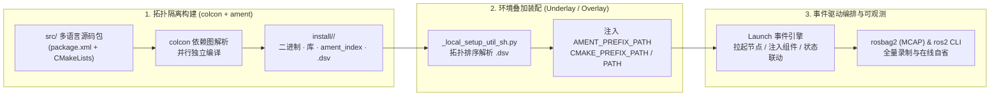

# 第 6 层：构建、编排与系统工程层（Build, Orchestration & Tooling）

> [返回 ROS 2 架构总纲](../README.md)
>
> **本层核心定位**：支撑大型机器人软件团队**高效编译、多层工作空间隔离覆盖、复杂多进程事件编排以及线上黑匣子数据回放诊断**的工程基础设施层。

---

## 一、从 ROS 1 工程工具链到 ROS 2 的全面现代化

| 工程环节 | ROS 1 | ROS 2 | 核心架构升级 |
| :--- | :--- | :--- | :--- |
| **构建编排与构建系统** | `catkin_make`（紧耦合单大工程合并编译） | **`colcon`（多包拓扑调度）+ `ament_cmake` / `ament_python`** | 彻底解耦编排器与单包构建规则；默认采用隔离安装空间（`install/<pkg>`），支持混合纯 CMake、Python 与 ROS 包统一编译。 |
| **运行时寻包与环境加载** | 扫描源码目录（`ROS_PACKAGE_PATH`）+ 嵌套 Shell 脚本 | **`ament_index` 资源注册表 + `.dsv` 数据驱动环境生成** | 查找包资源为常数级索引读取；Python 拓扑去重一次性生成 Shell 指令，跨平台且毫秒级加载。 |
| **多节点启动编排** | 静态声明式 `.launch` XML（缺乏条件分支与进程状态响应） | **事件驱动 Launch 框架（支持 Python / XML / YAML）** | 原生支持监听进程启动/崩溃退出、Lifecycle 状态迁移事件并触发连锁反应（如自动重启或全系统安全停机）。 |
| **数据录制与存储容器** | 单一私有 `.bag` 格式 | **插件化 `rosbag2` + 工业标准 `MCAP` 容器** | 单文件内嵌消息 Schema 定义（无需源码包即可跨端解析），高压缩率、支持按时间区间微秒级随机跳转与原始 QoS 还原。 |

---

## 二、本层核心机制细节大纲

### 6.1 构建系统（`colcon` + `ament`）与环境加载机制
* **职责边界厘清**：
  * `package.xml`（Format 3）：声明编译依赖（`<build_depend>`）、导出头文件依赖（`<build_export_depend>`）、运行期依赖（`<exec_depend>`，`<depend>` 为三者简写）及构建类型（`<build_type>ament_cmake</build_type>`）。
  * `ament_cmake`：提供现代化 CMake 宏（如 `ament_target_dependencies`、`ament_export_targets` 现代 Target 传递，替代易污染全局的旧式变量拼接），并在编译时自动向 `share/ament_index/resource_index/` 写入包与插件索引。
  * `colcon`：独立于 ROS 的顶层构建驱动器，解析全部 `package.xml` 构建有向无环图（DAG），按拓扑顺序并行调用 CMake/Ninja 或 `setuptools`。常用高效开发参数：`--symlink-install`（Python/Launch/YAML 软链免重编）、`--packages-up-to <pkg>`、`--cmake-args -DCMAKE_BUILD_TYPE=RelWithDebInfo`。
* **工作空间叠加（Underlay / Overlay）与 `.dsv` 装配流水线**：
  * `setup.sh` 跨空间级联调度 → `local_setup.sh` 单空间装配 → `_local_setup_util_sh.py` 读取 `.dsv` 拓扑去重生成 `export` 字符串并 `eval`。
  * **⚠️ 经典 Overlay 踩坑警示**：禁止在**已经 `source` 了上层 Overlay 工作空间的脏终端**里去重新编译底层空间或平行空间，否则会导致 `COLCON_PREFIX_PATH` 环形污染！

### 6.2 事件驱动的 Launch 系统编排框架
* **前端表达与统一内核**：虽然支持 Python（编程能力最强）、XML 与 YAML（配置清爽，Humble/Jazzy 已补齐绝大多数特性）三种前端写法，但底层全部编译为统一的 **`LaunchDescription` + 异步事件循环（asyncio Event Loop）**。
* **四大核心抽象**：
  * **Actions（动作）**：启动进程（`ExecuteProcess` / `Node`）、加载组件（`LoadComposableNodes`）、包含子启动文件、打印日志或触发关机（`Shutdown`）。
  * **Substitutions（惰性求值替换）**：在运行期而非解析期动态求值（如 `LaunchConfiguration`、`FindPackageShare`、`Command` 调用 `xacro`）。
  * **Events & EventHandlers（事件与处理器）**：监听 `OnProcessStart`、`OnProcessExit`（如关键驱动退出码非 0 时自动拉起备份或触发紧急停车）、`OnStateTransition`（监听 LifecycleNode 完成 `configure` 后自动触发 `activate`）。

### 6.3 命令行插件架构（`ros2` CLI）、`rosbag2`（MCAP）与诊断工具链
* **`ros2` CLI 零常驻进程插件机制与守护进程（Daemon）**：
  * 利用 Python `entry_points` 自动发现 `ros2node`、`ros2topic`、`ros2Bag` 等子命令扩展。
  * **隐藏的 `ros2 daemon` 机制**：因为无 Master 的 DDS 自动发现需要几百毫秒握手期，若每次敲 `ros2 node list` 都临时建一个新 Participant 会漏掉节点或很慢；因此 CLI 首次执行时会在后台悄悄拉起一个常驻 XML-RPC 缓存守护进程（默认存活 2 小时）维护图拓扑快照！（当修改了网络配置或 `RMW_IMPLEMENTATION` 后拓扑显示异常时，必须执行 **`ros2 daemon stop && ros2 daemon start`** 刷新缓存！）
* **`rosbag2` 插件化架构与 MCAP 存储优势**：
  * 分离前端录制缓冲队列、序列化转换层与后端存储插件（Storage Plugin：从早期容易锁库损坏的 SQLite3 `.db3` 全面转向 **`MCAP` `.mcap`**）。
  * **QoS 自动探测与覆写**：录制端如何自适应匹配发布者的 `Transient Local` / `Best Effort` QoS，以及回放时如何通过 `--qos-profile-overrides-path` 修正历史包的不合理 QoS。

---

## 三、工程排障与深度思考题（进入 Step 3 前的检验清单）

1. **为什么刚刚在另一台终端把 `RMW_IMPLEMENTATION` 从 Fast DDS 切成了 Cyclone DDS（或改了 Discovery 配置），再敲 `ros2 topic list` 看到的还是旧拓扑甚至一片空白？（结合 `ros2 daemon` 机制解释）**
2. **开启 `colcon build --symlink-install` 后，修改哪些文件可以立即生效无需重新 `colcon build`？为什么修改 C++ `.cpp`/`.hpp` 或新增一个新的 `.launch.py` 文件时仍然必须跑一遍构建？**
3. **为什么录制包含 `/tf_static` 的 `rosbag2` 时，即使 `/tf_static` 是在你敲下 `ros2 bag record` 之前 10 分钟发布的，`rosbag2` 依然能把它录进去？回放时如果从包中间第 30 秒开始播（`--start-offset 30`），静态 TF 还会生效吗？**

---

## 四、已归档与后续 Step 3 专题深潜规划

- 📂 `6.1 构建系统与环境加载机制/`
  - ✅ **已完成深度专题**：[ROS 2 环境加载机制与演进原理指南](6.1%20构建系统与环境加载机制/环境加载机制与演进原理指南.md)（完整拆解 `catkin` 到 `colcon` + `ament` 演进、`setup.sh` / `local_setup.sh` / `.dsv` 执行链路、五大核心环境变量分工与 `COLCON_TRACE=1` 排障）。
  - 📌 待补充专题：`ament_cmake` 现代 CMake Target 导出规范、`ament_index` 插件发现与 `pluginlib` 动态加载原理。
- 📂 `6.2 事件驱动Launch编排框架/`：编写生产级模块化 Launch 模板（融合 YAML 参数注入、Component 容器动态装载、Lifecycle 自动状态推进与进程崩溃守护）。
- 📂 `6.3 录制回放rosbag2与诊断工具链/`：深入 MCAP 文件内部块结构、C++ 直接读写 `rosbag2_cpp` 高速脱敏裁剪工具开发，以及 `ros2_tracing` 端到端延迟火焰图分析。
