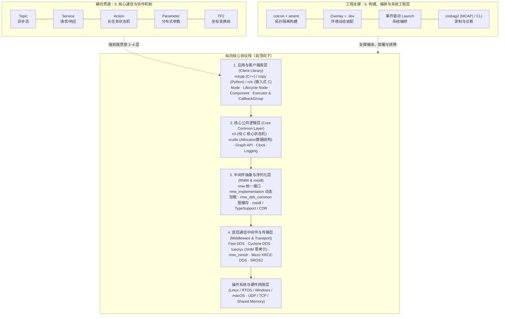

# ROS 2 架构设计与核心机制学习指南

> 本目录面向**具备 ROS 1 经验、以 C/C++ 为主力开发语言**的工程师，系统拆解 ROS 2 的分层架构与底层运行机制。
> 学习路径遵循**三步递进法**：
> 1. **全局总纲（本文档）**：建立 ROS 2 纵向分层与横向机制的全局坐标系，完成从 ROS 1 的增量认知映射；
> 2. **分层细节大纲（各层 `README.md`）**：逐层拆解内部模块边界、数据结构、核心痛点与思考题；
> 3. **专题文件夹深潜（各层子目录）**：针对具体机制展开协议剖析、源码调用栈走读与 C++ 实验验证。

---

## 一、ROS 2 五大核心设计理念

ROS 2 并非 ROS 1 的简单补丁升级，而是面向**工业级量产环境**与**现代分布式机器人系统**的彻底重构：

1. **去中心化与原生分布式**：取消单点中心节点（`roscore` / Master），基于工业标准协议（DDS / RTPS）或现代路由协议（Zenoh）实现节点自动发现与点对点通信，天然适配多机协同与弱网环境。
2. **严格分层与可插拔抽象**：将上层业务逻辑（`rclcpp`）、客户端公共状态机（`rcl`）、中间件抽象接口（`rmw`）与底层通信引擎彻底解耦，业务代码无需重编即可在运行期切换不同通信实现。
3. **面向生产与确定性控制**：引入节点生命周期状态机（Lifecycle Node）、硬实时内存与线程支持（Real-Time）、精细化服务质量控制（QoS）及链路级安全认证（SROS2），填补从“实验室原型”到“商业量产”的鸿沟。
4. **跨平台与全端覆盖**：摆脱对 Linux 的强绑定，原生支持 Linux、Windows、macOS，并向下通过 `rclc` / Micro XRCE-DDS 延伸至微控制器（RTOS / 裸机），打通“云—边—端”统一协议栈。
5. **现代软件工程规范**：全面拥抱现代 C++（C++17/20）、组件化动态加载（Composition）与进程内零拷贝、统一接口描述语言（IDL）及事件驱动的系统编排（Launch）。

---

## 二、全局分层架构全景与 ROS 1 演进映射

### 2.1 ROS 2 架构全景图（纵向 4 层栈 + 横向 2 大支撑域）

### 2.2 ROS 1 → ROS 2 核心架构演进对照表

| 架构维度 | ROS 1 | ROS 2 | 核心演进价值与机制变化 |
| :--- | :--- | :--- | :--- |
| **中心节点与发现** | 强依赖 `roscore`（XML-RPC 中心注册） | **去中心化自动发现**（SPDP/SEDP 或 Discovery Server / Zenoh Router） | 彻底消除 Master 单点故障，节点断线重连后自动恢复拓扑，天然支持多机分布式组网。 |
| **底层通信协议** | 自研紧耦合 `TCPROS` / `UDPROS` | **可插拔 `RMW` + 工业级 DDS / Zenoh** | 业务逻辑与底层传输解耦；利用 RTPS 状态机在无连接 UDP 上按需实现可靠重传与多播分发。 |
| **多语言架构** | `roscpp` 与 `rospy` 各自独立重写整套协议栈 | **纯 C 公共层 `rcl` + 薄语言封装 (`rclcpp`/`rclpy`)** | 消除不同语言客户端的行为分歧，升级核心特性时多语言同步受益，并孵化出微控制器端 `rclc`。 |
| **传输质量控制** | 仅支持简单的发送/接收队列长度 + `latch` | **精细化 QoS 策略体系 + RxO 匹配检查** | 按业务场景独立组合可靠性（Reliable/Best Effort）、持久性（Transient Local）、Deadline、Lifespan 等。 |
| **并发与回调调度** | `ros::spin` / `AsyncSpinner` + 全局回调队列 | **Executor（执行器）+ WaitSet + Callback Group** | 支持基于互斥组（MutuallyExclusive）与可重入组（Reentrant）的细粒度并发隔离，支撑复杂中台调度。 |
| **进程内与零拷贝** | 依赖独立宏与接口的 `Nodelet` | **原生 Component 组件化 + 进程内 `unique_ptr` + 跨进程 SHM** | 普通节点无需改写接口即可编译为共享库注入同一容器；同机支持 Fast DDS SHM / Iceoryx 端到端零拷贝。 |
| **节点状态管控** | 节点启动即运行，缺乏统一生命周期标准 | **原生 Lifecycle Node（生命周期状态机）** | 标准 4 主态 + 6 过渡态，总控层可按确定性时序执行配置、激活、降级停用与资源回收。 |
| **参数管理** | 中心化全局 Parameter Server | **节点自治分布式 Parameter + `/parameter_events`** | 参数归属各节点自身维护，支持写入前校验回调（Validation Callback）与原子事务更新。 |
| **构建与环境加载** | `catkin_make`（合并空间 `devel/` + Shell 脚本） | **`colcon` + `ament`（隔离 `install/` + `.dsv` 数据驱动）** | 支持 CMake/Python 多包拓扑并行构建，通过 Python 解析 `.dsv` 去重生成指令，毫秒级完成 Overlay 环境叠加。 |

---

## 三、C/C++ 工程中台典型落地点与调试工具矩阵

### 3.1 C/C++ 中台与系统开发中的核心落地点

在量产机器人架构中，`rclcpp`（C++）是核心中台、算法容器与硬件驱动的主力，纯 C 则用于底层库对接（`rcl`）或 MCU 固件（`rclc`）：

* **统一通信总线选型**：高频单向状态流（底盘里程计、传感器流、监控心跳）走 **Topic**；短耗时瞬时指令（权限查询、模式切换）走异步 **Service**；长耗时闭环任务（导航、抓取、OTA 升级）走 **Action**。
* **系统级有序启停（Lifecycle 管控）**：中台作为总控管理器（Lifecycle Manager），按依赖拓扑依次推进下游驱动与算法节点进入 `Configured -> Active`，异常时统一退回 `Inactive` 降级保护。
* **高并发防阻塞调度（Executor + Callback Group）**：中台常汇聚数十路 Topic 与多路 Service 调用，通过 `MultiThreadedExecutor` 配合回调组将高频控制环、耗时 I/O 与同步/异步请求隔离，规避死锁与队头阻塞。
* **高性能零拷贝链路（Composition + Loaned Message）**：在相机/点云接入、数据网关与日志落盘链路中，同进程采用 Component 智能指针零拷贝，跨进程采用共享内存（SHM）消除内核态内存拷贝与序列化开销。
* **弱网与多机中间件调优（QoS + 原生 XML / Zenoh）**：针对云边 Wi-Fi 抖动、跨网段或大规模节点发现风暴，结合 QoS 调优、DDS 厂商原生 XML（异步发送、Socket 缓冲、Discovery Server）或切换 `rmw_zenoh` 保障链路稳定。

### 3.2 常用开发、剖析与诊断工具速查

| 工具名称 | 类别 | 核心工程用途 |
| :--- | :--- | :--- |
| **`ros2` CLI（含 `ros2 doctor`）** | 命令行诊断 | 基于插件机制统一节点、话题、服务、参数、生命周期操作及网络/QoS 健康自检。 |
| **`rosbag2`（MCAP）** | 数据录制回放 | 默认采用 **MCAP** 容器格式（单文件自包含 IDL 消息定义、支持高吞吐索引与原始 QoS 还原），用于故障复现与回归测试。 |
| **Foxglove Studio / RViz2** | 三维与时序可视化 | RViz2 用于本地实时 3D 调试；Foxglove 支持跨平台远程查看与 TB 级 MCAP 离线秒级定位。 |
| **rqt 工具集** | 拓扑与状态面板 | `rqt_graph` 查看节点/话题拓扑，`rqt_reconfigure` 动态调参，`rqt_console` 聚合日志。 |
| **Fast DDS Monitor / Wireshark** | 中间件深度抓包 | 透视底层 RTPS 报文（SPDP/SEDP/Heartbeat/AckNack）、定位丢包重传与发现风暴。 |
| **`ros2_tracing` (`tracetools`)** | 低开销性能剖析 | 基于 LTTng 追踪消息从发布、中间件传输到 Executor 回调触发的微秒级端到端延迟。 |

---

## 四、分层学习目录与进度导航

按照“**先看各层 `README.md` 机制大纲（Step 2），再按需建立具体专题子目录（Step 3）**”的节奏推进：

### 1. [应用与客户端库层 (`rclcpp` / Client Library)](1.%20应用与客户端库层/README.md)
* `rclcpp` 面向对象封装、句柄模型与对比 `roscpp` 的结构演进
* 核心节点形态：普通 `Node`、`LifecycleNode` 状态机、`Component` 组件化与进程内零拷贝
* 并发调度内核：`Executor` 家族（Single / Multi / Static / Events）、`WaitSet` 与 `CallbackGroup` 并发隔离
* 定时器（`Timer`）与内部唤醒原语（`GuardCondition`）

### 2. [核心公共逻辑层 (`rcl` & `rcutils`)](2.%20核心公共逻辑层/README.md)
* 下沉纯 C 核心层的设计哲学：多语言语义统一与嵌入式 `rclc` 复用
* `Context` 与核心实体状态机管理（摆脱 ROS 1 全局单例限制）
* 无 Master 下的通信图谱自省（Graph API）
* 三类时钟抽象（System / Steady / ROS Time）与硬实时自定义内存分配器（`rcutils_allocator_t`）
* 分级日志架构（`rcl_logging` + `spdlog`）

### 3. [中间件抽象与序列化层 (`rmw` & `rosidl`) ⭐️ 中间件上篇](3.%20中间件抽象与序列化层/README.md)
* `rmw` 接口边界设计与 `rmw_implementation` 运行期 `dlopen` 动态切换原理
* ROS 实体到中间件实体的映射演进（`1 Context = 1 Participant`）与 `rmw_dds_common`（`ros_discovery_info` 图缓存）
* `rosidl` 接口编译期代码生成流水线（`.msg/.srv/.action` → `.idl` → 目标语言代码）
* 类型支持体系（静态 `TypeSupport` vs 动态 `Introspection` 反射）与 CDR 序列化内存对齐

### 4. [底层通信中间件与传输层 (DDS / RTPS / Zenoh) ⭐️ 中间件下篇](4.%20底层通信中间件与传输层/README.md)
* DDS DCPS 模型、RTPS over UDP 有线协议（HistoryCache + Heartbeat + AckNack 可靠重传）与隐藏后台线程模型
* 自动发现协议（SPDP / SEDP）、`ROS_DOMAIN_ID` 端口映射公式、发现风暴与 Discovery Server
* QoS 策略体系、RxO 兼容性矩阵与大数据帧（图像/点云）分片传输调优
* 三级零拷贝横向对比：`rclcpp` Intra-Process vs Fast DDS SHM vs Iceoryx `LoanedMessage`
* 主流中间件选型（Fast DDS / Cyclone DDS / `rmw_zenoh`）、厂商原生 XML 配置实战、micro-ROS（`XRCE-DDS`）与 SROS2

### 5. [核心通信与协作机制 (Communication & Coordination)](5.%20核心通信与协作机制/README.md)
* **Topic**：从 `publish()` 到订阅端回调执行的跨层全链路追踪
* **Service**：底层 Request/Response 隐式 Topic 对、回调内同步调用死锁成因与异步范式
* **Action**：`3 Services + 2 Topics` 组合协议与长耗时任务抢占/取消状态机
* **Parameter & TF2**：分布式节点参数服务 + `/parameter_events`；`/tf` 与 `/tf_static` 时间缓冲插值

### 6. [构建、编排与系统工程层 (Build, Orchestration & Tooling)](6.%20构建、编排与系统工程层/README.md)
* `colcon` + `ament` 多包拓扑隔离构建与 `ament_index` 资源索引机制
* 工作空间叠加（Underlay / Overlay）与 `.dsv` 环境动态加载原理
  * ✅ **已完成专题**：[ROS 2 环境加载机制与演进原理指南](6.%20构建、编排与系统工程层/6.1%20构建系统与环境加载机制/环境加载机制与演进原理指南.md)
* 事件驱动的 Launch 编排系统（Python / XML / YAML 与进程生命周期事件联动）
* `ros2` CLI 插件框架与 `rosbag2`（MCAP 存储引擎与 QoS 元数据还原）
